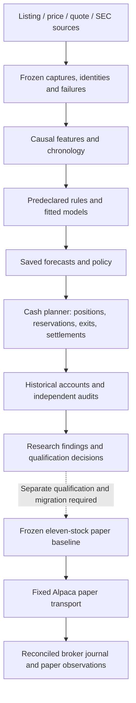

# Frontier Trading Agent — complete project handbook

Prepared October 1, 2026 for the owner, contributors and agent sessions with no prior conversation history. Repository: [private Frontier Trading Agent](https://github.com/shifosss/frontier-trading-agent).

This is the current consolidated account of the project's recorded academic, technical, product and operating decisions. It includes their practical reasons, source evidence, completed experiments, unsuccessful paths, architecture, setup, current authority and remaining work. Detailed original records remain preserved and indexed; no unrecorded rationale or missing evidence is invented. Current findings take precedence over older dated plans.

## Read this first

Frontier is a developing automated trading research system with an operating Alpaca paper baseline. **No research policy has been economically qualified for promotion; no live trading is enabled.** The intended product is broader hourly/daily stock selection and cash-funded short trading, not the retained weekly-entry paper baseline. All return figures below refer to their stated evaluation period, not a recurring weekly promise.

The documentation task defers new strategy research. It did not rerun the completed studies. The separately authorized stopped paper watcher was reconciled and resumed once; its dated operational check is recorded below. The owner-provided GitHub repository is private. Paper keys are stored as encrypted repository secrets, with local-machine setup and migration limitations explained in the recovery section.

Read the owner/context chapter for authority and scope, technical chapter for how the system works, research chapter for every hypothesis and outcome, and recovery chapter to restore or continue safely. The [source-document index](handover/document-source-index.md) preserves all137 indexed original Markdown documents; the [artifact inventory](handover/artifact-inventory.csv) records83,641 retained files totaling31.8GB. A clone contains selected code/evidence, not the entire raw corpus or private broker journal.

## Chapter navigation

- [Owner mandate and project decisions](#owner-context)
- [Technical architecture, software and operations](#technical-architecture)
- [All strategy hypotheses, experiments and findings](#research-and-results)
- [Recovery, GitHub publication and continuation](#recovery-and-continuation)
- [Study summary and exact recovery index](handover/study-catalogue.md)
- [All150 recorded decisions](handover/decision-register.json)

## System map



The arrows describe evidence and implementation boundaries. There is no automatic historical-winner promotion or live endpoint.


<a id="owner-context"></a>

## Frontier Trading Agent: owner context and governing decisions

Snapshot: October 1, 2026. This records the owner's instructions and decisions preserved in this session and the repository. It is a handover of recorded decisions, implementation, evidence and unresolved questions; it cannot recover undocumented conversations or establish missing source facts.

### Purpose and current conclusion

Frontier is a local research workstation and developing automated trading agent for a Canadian owner. The intended product scans a broad stock universe, evaluates multiple strategies, makes cash-funded trading decisions, tracks positions and orders, and eventually operates a qualified automated policy. The owner wants an effective, easy-to-use system and authorizes extensive historical research and implementation without repeated routine approval.

The project has implemented substantial research, data, model, accounting, interface and paper-operation infrastructure. **No historical strategy has been qualified for promotion as a profitable automated trading policy.** The running Alpaca paper operator is a separately authorized baseline. Software tests, accurate arithmetic, a positive exploratory path, and paper fills are different kinds of evidence; none establishes reliable live profits.

The latest completed study is the 100-issuer cash-backed earnings comparison of September 29. The next proposed research was disclosure novelty/timing using cached SEC metadata, but the owner requested this handover before continuation. **No original 8-K matching audit, new financial capture, new fit, or new economic test was run during this documentation task.**

### Owner mandate and its evolution

| Subject | Governing decision | Recorded reason or implication |
|---|---|---|
| Product | Build a powerful and usable automated trading agent, with autonomous research/testing and meaningful quality review | The owner wants a working result, rather than a research article explanation alone |
| Research inspiration | Start from RohOnChain's X article at `https://x.com/RohOnChain/article/2097303933081489605` | The article is an inspiration; its claims are not evidence that Frontier earns money |
| Markets | US stocks/ETFs and Canadian stocks/ETFs; broader hypotheses may include cash-funded options | Broad scope avoids treating the original 41-symbol starter list as the final opportunity set |
| Cadence | Hourly/daily decisions, intraday to approximately one-week individual-stock holdings | The owner rejected treating long ETF-style holdings as fulfillment of active trading |
| Evaluation window | Use extensive multi-year historical observations of repeated short trades | A five-year test can be useful when it contains many short trades; it must not be confused with holding one portfolio unchanged for five years |
| Strategies | Broader technical rules, learned models, multiple outputs and combinations are authorized | Added complexity is a hypothesis to test, not a quality metric or proof of advantage |
| Research capital | USD10,000 primary simulation; USD2,000 comparison | Larger balance tests affordability/fee effects. Both are simulated balances, not broker-reconciled funds |
| Return target | At least 5%, preferably 10–15%, per week on the entire account after costs | Aspirational research target. No guaranteed minimum, no selective active-week reporting, and no lowering risk constraints to hit it |
| Risk | Cash only, no borrowing/margin use; maximum 30% account drawdown constraint | A qualification limit must be distinguished from an automatic liquidation rule. Gap overshoot and unavailable intraday loss information remain visible |
| Funding | Mainly CAD; USD conversion is acceptable, with a stated preference for Norbert's gambit | No transfer is automated or authorized. Simulations keep FX/funding assumptions explicit |
| Contributions | Approximately CAD600–800 monthly, with CAD700 used illustratively | Not an initial cash declaration and not a broker balance |
| Account | Taxable/nonregistered | Taxes and funding costs are separate from the historical execution-cost scenarios; account-specific tax outcomes are not established |
| Brokers/access | Wealthsimple is the current active broker; Moomoo cash account also exists. Owner mentioned Longbridge, Alpaca and earlier ChatGPT connectors | Existing access may be used for authorized research; ChatGPT connector availability does not automatically imply Codex or brokerage execution access |
| Spending | Existing authorized access and free resources only; ask before new spending | No new subscriptions, hosting purchases or paid data were authorized |
| ETF reserves | Keep the regular ETF portfolios separate from active capital | Existing savings preferences should not be silently repurposed as active-trading funds |
| Automation | Routine reversible development/research/testing need no repeated approval | Explicit live deployment, real orders, options orders, spending and transfers remain outside the current authority |
| Paper authority | Existing USD100,000 Alpaca PAPER account only | Frozen paper transport, code identity, universe, durable order IDs and reconciliation govern operations |
| Historical priority | Improve strategies using existing historical evidence before relying on future shadow observations | Prospective observations supplement historical work; they are not a reason to stop useful historical development |
| Code quality | Apply Ponytail at standard/full level and review material implementations | Prefer reuse and readable code; avoid cosmetic churn, unnecessary abstractions and duplicated research engines |
| October 1 priority | Document all recorded decisions and prepare private GitHub publication before new research | A person or new agent should understand and continue the project without this conversation |

#### Reserved ETF portfolios

The owner reported approximately CAD1,200 in XGRO, outside this project's active-trading scope. A separate approximately CAD1,000 regular portfolio was described as 70% equities, 22% bonds, 8% gold. Within the equity allocation: XEQT54%, VDY12%, QQC4%, Canadian CHPS1%, VTV6%, VFV6%, SPMO8%, SMH1%, IXJ5%, XBI3%. These are the owner's described preferences, not a current reconciled securities ledger. Limited modifications preserving those preferences were allowed; no actual modification or transfer is established here. This allocation must not be counted as available active-trading cash.

#### Scope counts and interpretation

The owner's rough market-size estimates were a request for broad coverage, not authoritative listing counts. The project records requested, discovered, usable, eligible and failed instruments separately. A present-day listing universe is not the historical population, and incomplete Canadian prices or delisted histories cannot be cured by quietly replacing names. An 11-stock operational paper universe, the old 41-symbol starter scanner, and the broad historical discovery universe serve different purposes.

### Decision authority and approval boundaries

Proceed autonomously with reversible local development, read-only broker/data diagnostics, historical experiments within declared limits, meaningful tests and code reviews. Use a predeclared hypothesis and fixed sample/cost choices before reading economic outcomes. Keep each attempt, failure, warning and excluded denominator.

Only the fixed Alpaca **paper** transport may submit the currently authorized baseline's simulated orders. Never substitute a live endpoint, place real securities or option orders, transfer funds, buy services, authenticate the owner into a broker, change the active eleven-stock paper universe, or automatically promote a historical winner. A new operational migration requires a separately qualified policy and appropriate authority.

Uncertain submissions, rejected exits, unsupported actions, code drift and unexplained funds or holdings require reconciliation. Preserve journals and durable identifiers; never erase the journal or blindly resubmit. Restart the initialized paper watcher once only after verifying absent owned processes, a free lock, frozen identity and reconcilable journal. Research workers and paper workers have independent locks and lifecycle.

A request to pause the goal stops research/development and scheduled research while retaining evidence. Separately authorized paper operations remain separate unless the owner explicitly stops them. The owner later resumed the goal. The present documentation request defers new research until the handover is ready; it does not authorize a live trading transition.

### Key decision register

These are the recorded project-level choices. Detailed technical and academic registers follow elsewhere in this handbook.

| ID | Decision | Reason | Evidence/status |
|---|---|---|---|
| OWN-001 | Treat autonomous trading as the product objective | Owner explicitly redirected from article-based research to an automated agent | Owner instructions; product goal, unfinished |
| OWN-002 | Preserve historical evidence ahead of new forward observation | Historical experiments can reject/refine hypotheses now | Owner instructions; implemented research factory |
| OWN-003 | Keep daily short-hold and intraday studies separate from legacy long-hold/paper baselines | Changing a global horizon or watcher frequency does not implement a new trading cadence | `docs/trading-cadence.md`; implemented daily lane |
| OWN-004 | Evaluate whole-account weekly outcomes including idle and losing weeks | Avoid turning sparse profitable trades into a misleading weekly return promise | `docs/capital-and-return-objective.md`; implemented experiment reporting |
| OWN-005 | Compare USD10,000 and USD2,000 without claiming broker funds exist | Affordability, fixed fees and risk sizing depend on account scale | Owner instructions and earnings/ETF definitions |
| OWN-006 | Keep CAD risk and ETF reserves separate from USD active simulation | Conversion and risk base are different from quote currency | `config/mandate.json`, funding study |
| OWN-007 | Retain all failed variants and source exclusions | Selecting only successful paths creates hindsight bias | Every frozen comparison; no promoted winner |
| OWN-008 | Use training-only choices, explicit chronology and purged labels | Prevent information from future outcomes entering decisions | Multi-model, conditional and earnings specifications |
| OWN-009 | Test richer models without requiring a simple profitable baseline first | Owner authorized complexity; simple baselines remain controls | Multi-model/earnings comparisons complete; complex models did not establish an edge |
| OWN-010 | Preserve immutable code/source/policy identities | A changed model or journal is a different experiment or operation | Model artifacts, research attempts, paper seven-file identity |
| OWN-011 | Distinguish fees, quoted spreads and realized fills | A quote sample is not an execution guarantee; fee assumptions must not be chosen from profits | Cost-evidence and broker-feasibility documents |
| OWN-012 | Keep free/existing-access spending boundary | Owner explicitly withheld new spending authority | Premium access failures retained, no purchases |
| OWN-013 | Use a private repository for publication | Owner will create it and supply its URL | Private `shifosss/frontier-trading-agent` provided and verified October1 |
| OWN-014 | Document actual reasoning and mark gaps rather than invent it | New readers need trustworthy recorded decisions, not retrospective certainty | This handover; unknown rationale remains unknown |

### Chronological navigation

The project grew rapidly from September 18 through September 29, 2026. Git preserves the sequence: engine qualification and immutable datasets; bounded model-provider access; local workstation; Ponytail review; scanner/dividends and CAD/USD funding; paper operator; broad current-universe research; historical-first daily short-hold research; richer model tournament; saved daily model bridge; persistent daily rehearsal; strategy interactions, timing and conditional forecasts; calibration shrinkage; actual-minute intraday; original-filing pilot; larger-capital mandate; ETF reversal/options access; 100-issuer cash-backed earnings preparation and completed results. A new reader should read the current reconciled handbook before the older dated plans. Older documents retain the assumptions and state at their time; they do not override newer results.

Git history is retained, not rewritten. Its commit identities allow a reader to recover earlier code and explanations. Full recorded decision rationales and underlying definitions are referenced through the detailed research and technical sections and the publication inventory.

### Glossary for a new reader

- **Requested/discovered/usable/eligible**: distinct denominators. A downloaded series need not have the required causal history, complete labels or tradable decision inputs.
- **Capture**: source acquisition, not an economic strategy test.
- **Attempt/definition**: a durable run record and its declared immutable inputs/settings.
- **Current-member history**: today's eligible listings studied backward; it omits some historical delisted/changed members and carries survivorship limits.
- **Point-in-time**: only facts public and usable at a stated historical decision time. Revised vendor history is not automatically point-in-time evidence.
- **Purging**: remove fitting/calibration labels whose outcome windows reach the next chronological partition.
- **Calibration**: estimate forecast correction/weights/bins using a separate earlier period. It cannot use the later test period.
- **Head**: a model output such as a horizon return or downside. Multiple outputs do not imply transformer attention.
- **Next-close**: an explicitly declared later-close simulation timing convention; distinct from earlier opens and intraday quotes.
- **Reservation**: money committed to an immutable intended order; it cannot be reused before resolution.
- **Settled cash**: proceeds available only after the applicable dated settlement schedule, distinct from marked equity and broker margin buying power.
- **Paper**: simulated broker orders/holdings in the fixed Alpaca paper account. They are not real investments or demonstrated live fills.
- **Shadow/prospective**: observations recorded after the policy is fixed; separate from historical fitting and paper-account operations.
- **Qualified**: passed the specific stated evidence/engineering/economic criteria. Source qualification, arithmetic verification and profitable strategy qualification are separate.
- **Promotion**: adopting a research candidate into an operational policy. No current historical strategy has been automatically promoted.
- **Drawdown**: decline from a previous account-equity peak. Daily-close observed drawdown does not bound intraday loss or gaps.
- **S/Q**: original income-seasonality and cash-backing features in the filing studies; exact formulas, contexts and failure rules are in the research section.
- **CIK/SIC**: SEC issuer identity / industry classification. Original matching filer-header SIC and today's profile SIC are different evidence.
- **Corporate action**: split, dividend, merger, share conversion or other issuer event requiring price/share/cash/time treatment.
- **Provenance**: original source, response bytes, hash, retrieval/publication times and mappings that let a reader trace an observation.


<a id="technical-architecture"></a>

## Frontier Trading Agent: technical handover

Prepared on 2026-10-01 for a reader with no prior session context. This document describes verified source behavior, the retained research interfaces and the remaining engineering work. It does not certify an economically successful strategy or broker readiness. Operational observations quoted elsewhere are dated snapshots; this technical compilation used read-only source inspection. Root's separately authorized paper restart is recorded in the operational chapter; no research study was rerun.

### Scope, authority and what exists

Frontier is a local Python research application with a React dashboard, historical source capture and account simulations, immutable fitted-model artifacts, persistent historical policy rehearsals and one separately initialized Alpaca paper operator. The owner wants hourly or daily decisions and independent stock holdings lasting intraday to roughly one week. USD10,000 is the primary simulated research balance and USD2,000 remains a comparison. The requested 5%, preferably 10–15%, weekly gain concerns the entire account after costs; it is a research objective, not a promised minimum. Cash-only/no-borrowing, the 30% drawdown constraint, CAD risk context, taxable account and separate reserved ETF portfolios remain authoritative. Simulated research balances are not reconciled broker funds.

Use existing authorized access and free resources. New spending, live trading, actual options orders, funds transfers and authenticating the user into a broker are outside the current authorization. The authorized execution transport is only the existing Alpaca PAPER account. Do not substitute a live endpoint, change the active eleven-stock universe, promote a historical winner automatically or replace the journal. The baseline paper account and richer strategy research have distinct policies and identities.

No tested strategy has qualified for promotion. A running paper process, a successful software test, a source-qualified financial fact, a model forecast and a profitable exploratory account each establish different things. Arithmetic and identity checks verify a simulation under its stated conventions; they do not establish real fills, complete corporate actions, historical membership completeness or reliable profitability.

Primary authority and orientation: `config/mandate.json`, `docs/trading-cadence.md`, `docs/historical-research.md`, `docs/automated-trading-plan.md`, `docs/daily-model-bridge.md`, `docs/paper-operator.md`, current result reports and original attempt definitions. Older design documents and preparation interface files can contain historically accurate statements such as 'fits have not run' that were superseded by completed results. Preserve their history and use the later completion artifact for current research status.

### Architecture and execution lanes

The package lives in `src/frontier`; the frontend lives in `frontend/src`; focused integration and behavior tests live in `tests`; isolated authored studies, immutable attempts and evidence live under `.qualification`. There is no single universal engine. Five execution paths have materially different timing and action contracts:

| Lane | Decision and fill convention | Account/state | Meaning |
| --- | --- | --- | --- |
| Strict dataset/Nautilus replay | Signal uses available closing observations; order executes at a strictly later eligible daily/hourly opening | Native USD and CAD cash balances, synthetic opening quotes, fixed fees/slippage | Engine replay under a strict raw dataset contract |
| Exploratory daily historical cash study | Every-session screening; general daily lane fills at next-session close with 1/3/5-session independent holds | Whole shares, retained reservations, pending exits, receivables and dated settled cash | Repeated short trades over years using retained current-member/revised-vintage sources |
| Saved-model historical rehearsal | Reuses frozen model/policy forecasts and the daily cash engine across continuous chunks | Durable SQLite journal carrying positions, reservations and settlements; research fills are atomic | Execution-state qualification and exact restart/reproduction, not a broker integration |
| Actual-minute intraday pilot | Completed opening-hour signal; 10:46 ET entry and 12:46 ET exit | Retained SIP minutes, whole shares, fixed reservations and historical settled cash | Separately completed repeated intraday trades; all four pilot accounts lost |
| Active Alpaca paper baseline | Weekly entry window, daily close-confirmed exit decisions, at most 20 holding sessions | Broker-owned orders/fills with reconciliation and a frozen local journal | A separate retained baseline, not fulfillment of the desired hourly/daily short-hold mandate |

The scanner provides a watchlist, diagnostics and hypothetical sizing. Prospective frozen observations and broad cohort observations provide supplementary evidence. Neither is automatically a compounded trading account. The earnings event lane also has its own declared public-availability/entry clock; do not generalize one lane's timing to another.

Why this separation matters: changing a global horizon constant or worker polling interval would not implement a new trading cadence. A saved forecast must pass an explicit account policy and broker migration qualification. The daily model bridge, the persistent historical rehearsal and the active weekly paper baseline should remain separately versioned.

### Setup and launch

`pyproject.toml` declares package `frontier-trading` version 0.1.0, Python `>=3.13,<3.14`, Hatchling packaging and CLI entrypoint `frontier = frontier.cli:app`. Core dependencies include Pydantic 2, NumPy, pandas, PyArrow, DuckDB, exchange-calendars, FastAPI, Uvicorn, Typer and HTTPX. NautilusTrader is pinned at 1.231.0 and scikit-learn at 1.7.2; the lockfile is `uv.lock`. Frontend dependencies use React/ReactDOM 19.1.1, TypeScript 5.9.2, Vite 6.3.5, React plugin 4.7.0 and Prettier 3.6.2.

Fresh installation commands, offered as reproduction instructions rather than commands executed during this handover:

```powershell
uv sync --frozen
npm --prefix frontend ci --cache .cache/npm
npm --prefix frontend run build
.venv/Scripts/python.exe -m frontier.cli doctor
.venv/Scripts/python.exe -m frontier.cli demo
.venv/Scripts/python.exe -m frontier.cli serve
```

`--workspace PATH` is a global option before the subcommand; otherwise the workspace is the current directory. `serve` defaults to loopback `127.0.0.1:8765` and imports a fictional demonstration dataset only when no dataset exists. A fictional fixture verifies wiring; it is not market evidence.

`Launch Frontier.cmd` delegates to `scripts/start.ps1`. That launcher resolves the workspace and local virtual environment, builds the frontend if `frontend/dist/index.html` is absent, validates that `/api/status` reports service `frontier-research` and the exact workspace, and refuses a conflicting service/port. Its readiness wait is 60 seconds. `-Port` and `-NoBrowser` are supported. The Vite development server binds loopback and proxies `/api` to port 8765.

`scripts/start-paper.ps1` defaults to a 300-second poll interval with a 30-second minimum. It validates credential availability without fetching the broker, requires the existing initialized journal and reuses only a process whose saved PID, executable, command and workspace match. It launches hidden and appends operator logs, storing a PID file under `artifacts/paper-operator`. It does not initialize a journal.

`src/frontier/processes.py` detaches background workers with independent append logs, null stdin, `close_fds=True` and Windows `CREATE_NO_WINDOW`. A returned PID means process creation, not readiness or health. These launchers are local host processes; the repository does not install an OS startup service or cloud scheduler. The host must remain awake and available.

### Credentials and access boundaries

The paper transport reads `FRONTIER_ALPACA_PAPER_KEY` and `FRONTIER_ALPACA_PAPER_SECRET`. It takes a complete pair from process environment first. Only when both are absent does it read the exact pair from Windows `HKEY_CURRENT_USER\Environment`; a partial pair is refused and sources are never mixed. There is no UI secret store, automatic `.env` loader or broker login automation. Never put credential values in documentation, datasets, logs, Git commits or model manifests.

The Longbridge adapter uses an existing authenticated CLI found on PATH or at `~/AppData/Local/Programs/longbridge/longbridge.exe`; the owner performs authentication. Existing ChatGPT connectors do not automatically grant the standalone application credentials or data entitlements. Availability checks distinguish an executable/credential configuration from actual tested source access.

The optional Codex proposal subprocess intentionally removes inherited `OPENAI_API_KEY`, `CODEX_API_KEY` and `AZURE_OPENAI_API_KEY`, avoiding silent API billing. It uses existing authorized ChatGPT CLI authentication. The bounded proposal subprocess is ephemeral, read-only and tool-restricted; this restriction applies to generated proposals, not to the maintainer's Codex development session.

### Domain and immutable dataset contract

`src/frontier/domain.py` uses strict Pydantic models with unknown fields refused and nonfinite numbers disallowed. Currency is USD or CAD. Venues are XNAS, XNYS, ARCX and XTSE; US venue session rules use XNYS and Canada uses XTSE. Instrument IDs are exact `SYMBOL.VENUE` identifiers and carry stock/ETF and exposure-group metadata.

`DatasetMetadata` schema version 1 records name, synthetic/historical mode, source/source URL, retrieval time, usage, availability basis (`observed`, `documented`, `inferred`, `unknown`), raw adjustment policy, complete/unknown action status, instruments, 1d/1h interval and limitations. A `DatasetManifest` records the 64-character content SHA identity, bounds, row counts, saved files, original source identities and ingestion time.

`src/frontier/data.py` validates and stores these tables:

| Table | Required columns | Important additional fields |
| --- | --- | --- |
| Bars | `instrument_id,event_time,available_at,open,high,low,close,volume` | `revision_id` defaults to original; `ingested_at` appended |
| Actions | `instrument_id,event_time,available_at,type,cash_amount,currency,ratio` | dividend `payable_at`, revision and ingestion identity |
| FX | `event_time,available_at,usd_cad,source` | revision and ingestion identity |

Times must be offset-aware and normalize to UTC; availability cannot precede event time. OHLC must be finite/positive and respect high/low bounds; volume is nonnegative. Instruments and action currencies must agree. Dividend/split relevant values must be positive and unrelated fields blank. Duplicate logical revisions/availability are refused.

Daily endpoints are official exchange closes. Hourly endpoints follow official session open plus one-hour buckets, including a final partial hour and early closes. Holidays or nonmatching endpoints fail. Missing observations are reported rather than filled forward. `as_of` includes only rows whose event and availability clocks are both at or before the decision, selecting the latest available logical revision. FX is likewise selected only after its availability.

Ingestion writes staged source files and Parquet, records their hashes and atomically renames a content-addressed dataset directory. Loading rehashes files, recomputes identity/metadata and checks exact normalized semantic values through DuckDB against retained source frames. `ingested_at` is removed only for this normalization comparison. Original event time, public availability, retrieval and ingestion are distinct clocks; one must never stand in for another.

### Persistence and identity

Runtime storage is under the selected workspace. Important paths are:

| Path | Role |
| --- | --- |
| `data/datasets/<sha>/` | Manifest, originals and bars/actions/FX Parquet |
| `data/frontier.sqlite` | Run registry and global evaluation-access history |
| `artifacts/<run-id>/` | Result JSON and HTML report |
| `artifacts/campaigns`, `model-campaigns`, `frozen`, `observations` | Immutable declared comparisons and prospective observations |
| `data/scanner`, `artifacts/scans/<id>/scan.json` | Raw scanner captures, manifests and watchlist results |
| `data/research/universe`, `data/research/history`, `artifacts/research-lab` | Current listing snapshots, broad capture cache, jobs/results/logs |
| `data/historical`, `artifacts/historical-lab` | Historical index/cache, worker lock, retained jobs and studies |
| `artifacts/daily-candidates/<id>/` | Build attempt, report, model manifest and fitted heads |
| `artifacts/candidate-replays/<id>/` | Durable model-policy rehearsal journal, writer lock and report |
| `data/operator.sqlite`, `data/operator.lock` | Initialized paper journal and whole-cycle operating-system lock |
| `artifacts/paper-operator`, `artifacts/service` | Append logs and PID files |
| `.qualification/` | Isolated authored experiments, attempts, checks, compact evidence and archives |

The run registry has `runs` records with identity, RUNNING/COMPLETED/FAILED status, creation/completion clocks, configuration, code/runtime identity, summary, artifact path and failure. Only a running record can transition terminally. `evaluation_access` records dataset/window/campaign/purpose/time; closed inclusive windows are checked globally per dataset. A new campaign name does not reset already exposed evaluation data.

Paper SQLite tables are `state`, `cycles`, `intents`, `observations` and `flows`. Session is the cycle key. Plans, new risk state and intents save atomically. Observations retain broker snapshot/risk; flows record already observed external funding with evidence. The operating-system lock spans the whole cycle.

The candidate rehearsal journal has one immutable `identity`, chained `chunks` and retained `attempts`. SQLite synchronous mode is FULL. Each chunk binds its prior state digest, payload digest and session cursor. Model, data, account, policy, period, costs, runtime, settlement and code identities are checked. Chunk size may change because it is a checkpoint size, not a trading decision interval. Completed replay is idempotent after full verification. The journal is authoritative; never reconstruct account state from a display report or delete a failed attempt.

The default `.gitignore` excludes data, artifacts, `.qualification`, caches, virtual environments, dependencies, generated frontend output and `.env` secrets. A source clone alone does not contain the raw sources, trusted model binaries or live paper journal needed to reproduce saved research or resume operations. The publication/handoff curation must preserve project-authored research code and compact evidence while separately inventorying retained local raw/model/journal assets.
### Replay, corporate actions and metrics

The strict engine is `src/frontier/replay.py`. Current construction uses one venue with NETTING/CASH behavior, one account and separate native USD/CAD starting balances with no default base currency conversion. A fixed first-fill fee is charged in native currency. Historical qualification notes about older two-account probes describe earlier implementation versions, not the current constructor.

The available closing signal submits for a strictly later eligible opening event. Opening bid/ask quotes are synthesized from raw bars with declared fixed slippage. They are not observed spreads, market-impact estimates or closing-auction fills. Run configuration defaults include USD10,000 and CAD10,000 starting balances, CAD reporting base, native commission 1, slippage 5bps, seed 1729, incomplete-actions opt-in false, available-close decisions and next-eligible-open execution.

Known splits are rejected. Opting into unknown action coverage does not enable known unsupported splits. The narrow supported dividend path requires an explicit payment date, unrevised/unambiguous event mapping, availability at the ex event, an official opening ex event and payment no earlier than ex. Gross entitlement is based on shares held before ex; the receivable belongs in NAV rather than spendable cash, payment occurs at the first eligible event at/after payable time, ex-date buys do not inherit entitlement and selling before payment retains the receivable. This does not implement every issuer/broker action, withholding, fractional-share or merger conversion.

Result schema version 1 includes configuration, dataset, summary, equity, decisions, fills, positions, balances, dividends, receivables, exposure drift, unfilled orders and engine identity. Qualified `total_return` is unavailable when replay is incomplete; exploratory/raw return is separately identified. Metrics include native fees/slippage, daily NAV accounting from initial capital, 252-session annual statistics and a descriptive 500-resample circular five-day bootstrap. Bootstrap uncertainty is not a forward profit forecast.

Replay code identity is built from the declared engine modules and lockfile using normalized UTF-8 text. Some other pipelines use exact file-byte SHA identities. Reproduce the identity algorithm named by the artifact rather than assuming all hashes use the same normalization.

### Sources, scanner and universe

`scan_data.py` retains scanner columns `symbol,session,available_at,close,adjusted_close,high,low,volume`. The free chart capture requests approximately five years, verifies source symbol/currency and adjusted-close alignment, assigns official close plus one minute as inferred availability and retains a cutoff. Invalid or missing values remain reported limitations. These are subsequently retrieved adjusted histories, not point-in-time archives.

The scanner's fixed diagnostics use 20/60-session momentum, 20-session volatility, a 50-session trend and at least 63 rows. Liquidity floors are USD5 million/CAD1 million average dollar activity. Hypothetical books have at most five positions per currency, 20% each and 0.5% NAV divided by two ATR for risk sizing. Its five-session next-close diagnostic uses declared 20bps and 40bps stress scenarios and 5bps sizing slippage. ETFs can provide context and reserved-portfolio separation, but the primary stock scan is not a trade authorization or a probabilistic promise.

`funding.py` can model a one-time CAD-to-USD conversion using dated Bank of Canada FX and a declared fee profile, subtracting CAD and adding USD in a hypothetical account. It does not transfer funds. Monthly CAD additions and research balances must not be counted as existing settled broker cash.

`research_universe.py` captures dated current listing directories from NasdaqTrader, the TMX workbook/security directory, CSE and Cboe Canada sources, retaining raw/source identities, original requested counts, exclusions and usable membership. It maps common shares/security classes and native currency explicitly. ETF coverage is predeclared rather than assuming every instrument's leverage/type is verified. Current snapshots cannot reconstruct historical delistings, historical security/entity changes or a survivorship-free universe.

`historical_data.py` defaults broad history to year 2000. It preserves chart sources, reported splits and adjusted marks and reconstructs nominal OHLC/inverse volume from reported later split factors. Vendor action coverage remains incomplete and is not independent corporate-action verification. Merger-related discontinuities can survive this reconstruction. Dollar activity must use original vendor close and its same-row original vendor volume; combining reconstructed nominal close with original volume is invalid.

`sources.py` caches the free Bank of Canada Valet USD/CAD series. It records Toronto noon as event and 16:30 Toronto as inferred availability; only previously available FX can be used. A source timestamp is not proof of an executable foreign-exchange price.

The retained Longbridge path invokes the existing CLI for raw 1h history, with an explicit period, dates, adjustment `none`, intraday session and JSON format. The adapter refuses theoretically oversized or returned 1,000-row windows rather than assuming unreported pagination is complete. Regular-session start buckets map to their session-aligned end, including a final partial bucket. Availability is inferred as end plus one minute; capture must not predate it. Duplicate endpoints are refused. The retained integration maps SPY to `SPY.ARCX`; it is not broad Canadian hourly coverage.

Existing Alpaca credentials have also demonstrated bounded US historical SIP hourly/minute access in separately recorded probes. Vendor clock-hour opening buckets can mix premarket and regular-session activity. Verified minute aggregation using exchange-session boundaries, or a separately declared convention, is necessary before regular-session hourly claims. Never manufacture hourly observations from daily bars. Preserve pagination, feed, raw adjustment, source entity mapping, partial sessions, missing minutes, revisions and the free SIP availability delay.

Retained Alpaca corporate-action comparison preserves disagreements with source prices. Cash-dividend category coverage does not imply all action classes are mapped. Failed entitlement probes, including the historical option-chain premium failure, are final evidence of that access attempt rather than permission to buy services, change identity or silently replace a source.

### Research workers and retained failures

The broad and historical labs are separate jobs with source caches and SQLite worker locks. Status JSON is an observation, not a process handle. A saved RUNNING status with a free actual lock is interrupted; a completed main historical status says nothing about a separate source worker. Verify command ownership, actual lock and fresh journals before starting, resuming or terminating anything.

Capture proceeds in bounded batches (including 50-symbol historical batches) and saves raw sources/cache indices so interrupted work can resume. Capture-only mode refreshes sources without rerunning account studies. Historical source-run reuse verifies the frozen request, membership, usable counts, index/raw identities, cutoff and failures; it cannot rediscover a new universe under an existing comparison.

Failures are part of the experiment. Retain every original requested symbol/event, unavailable history, source access error, failed account and unknown denominator. Missing required future marks invalidate the corresponding path and preserve its incomplete prefix; they must not become a retrospective eligibility filter or a profitable-prefix summary. Do not rerun unchanged completed studies or retry completed access failures just because outcomes or a source boundary were inconvenient.

The web process uses a nonblocking in-process `ENGINE_LOCK` for foreground engine operations, returning busy HTTP409. Cross-process research workers require their own durable locks. Dedicated SEC source and capture locks protect discovery/capture/collection and economic readers. A PID returned by the background launcher does not replace these protections.

### Historical strategy and model interfaces

The retained legacy technical-rule study uses 5/10/20-session horizons and 20/40/100bps scenarios, a USD/SPY book and a CAD/XIU book, warmup 200, training 756 and test blocks 252. Families include momentum, trend pullback, mean reversion and breakout, with longer-momentum and market-trend variants. It is a baseline; it does not satisfy the owner's updated short-hold mandate.

`short_horizon_study.py` implements version `daily-short-hold-v1`: 1/3/5 sessions, screening every completed session, next-close entry, independent positions, five slots, a 20% position cap and 0.5% two-ATR sizing. It compares 20/40/100bps scenarios. Rolling rule selection uses only training blocks, requiring a minimum trade count, positive block stability and a drawdown/utility rule. The unchanged completed grid did not justify promotion. Faster reselection is a separately declared experiment, not a constants edit.

`ensemble_features.py` builds 27 ordered causal inputs: short/medium returns, 12-minus-1 momentum, relative log returns, volatility and its ratio, ATR fraction, distances to moving averages, prior breakout/drawdown, prior activity/turnover, market trend/returns/volatility, cross-sectional return rank and lagged residual volatility. Long-window missing values are handled by fitting-only preprocessing rather than future-informed row selection. The original multi-model target layout has six outputs: return and daily-close downside for each of 1/3/5 sessions.

The fixed shared model fitter uses Ridge alpha100; ExtraTrees 48 estimators/depth8/minimum leaf64/max features0.8; shallow histogram gradient boosting 60 iterations/15 leaves/learning rate0.05/L2 10/minimum leaf64/no early stopping; and an MLP with hidden widths32,16, ReLU/Adam, 60 iterations, alpha0.0001, learning rate0.001 and no early stopping. Median imputation plus missing indicators is fitted on training only. Ridge and MLP scale features; MLP also scales targets. Downside forecasts clip at zero; return predictions are otherwise unbounded. Thread limits and prediction batching are controlled. The MLP has shared hidden layers and multiple outputs, not transformer attention.

Original ensemble folds use 504 fitting sessions, 252 calibration sessions and 252 test sessions, capped at 96 samples per date with seed1729. Labels reaching the next partition are purged. All test membership/inputs are causal; unavailable future labels are not used to choose forecast membership. Calibration weights use positive return-MSE improvement against a fitting-only mean, independently by horizon, with the same weights applied to the risk head. Equal-weight fallback is defined behavior, not a successful qualification. Diversification refuses high 60-session correlation or insufficient paired observations. Older fold accounts flatten positions at fold boundaries; do not describe them as continuously held execution accounts.

`daily_policy.py` provides the shared immutable forecast score and cash planner. Under its declared convention score is `mu*(1-half_cost)-2*half_cost-0.5*positive_downside`. The cash planner applies whole-share sizing, NAV/cash/ATR caps, held/reserved slots and supplied correlation exclusions, and emits an audit. Reconciled state belongs to its caller. Defaults are five positions, 20% cap, 0.5% two-ATR sizing, downside penalty0.5, next-session close and 1/3/5-session horizons.

`ConditionalPolicy` compares estimated monetary utility using quantity-dependent entry and exit fees: notional times expected return minus entry fee minus exit fee at predicted exit notional minus downside penalty. Return must exceed -1 and downside be finite/nonnegative. Ranking can use utility per fraction/dollar. Fee-inclusive reservations freeze intent identity and maximum quantity. Quantity may decrease at actual fill to respect the reservation; fill-time reranking, replacement or selecting a more favorable runner-up is prohibited.

`execution_costs.py` supports proportional, `wealthsimple_usd` and `moomoo_ca_us` scenarios. Round-trip bps is split into half legs (`bps/20000`). The Moomoo scenario includes declared per-share/minimum commission and platform fee and a separately rounded sell SEC fee; low-price treatment is explicit. Current broker tariffs are counterfactual historical scenarios, not archived fee schedules. Account subscriptions, funding/FX, tax, unverified venue charges and actual impact are separate. A purposive quote sample is not calibrated fills or a universe-wide slippage bound. Never choose costs after observing profits.

`historical_settlement.py` uses date-specific T+3, then T+2 from 2017-09-05, then T+1 from Canada's 2024-05-27 and the US's 2024-05-28. Spendable proceeds wait for the appropriate bank/exchange calendar intersection at session opening. This is conservative and can delay availability relative to actual broker/CDS rules; state that convention rather than claim exact broker settlement.

### Saved models and persistent account rehearsal

`model_artifact.py` saves `fitted-heads-v1` artifacts in new directories: compressed `heads.joblib`, manifest, ordered features/heads, fitted preprocessing/calibration, metadata, runtime and checks. Reload verifies identity and exact bytes before deserializing from the already verified bytes. This closes a file-replacement race, but a hash is not a trust boundary for malicious pickle/joblib content. Load only project-produced trusted local artifacts.

`candidate_daily.py` records a unique build attempt before loading data, binding all request parameters. Default isolated preview is USD2,000, calibrated ensemble, five sessions and 40bps. It reuses a saved capture, declares fitting/calibration/signal windows, purges both boundaries, saves fitted heads and verifies exact deterministic reload forecasts. An isolated cash preview has no broker positions or order authority. A no-entry result must remain visible rather than be cured by lowering thresholds.

`candidate_replay.py` uses the saved model and policy across persistent reconciled historical positions, immutable reserved orders, scheduled exits and settlements without fitting again. It journals every attempt and chain boundary and supports exact restart after a declared chunk. It does not simulate broker partial fills; full daily broker integration with partial-fill remainders, reconciled reservations and settlement remains unfinished.

The completed earnings strategy reused these interfaces rather than duplicating them. See `.qualification/earnings-quality20260928/model-inputs/event_inputs.py`, `models/earnings_models.py`, `accounts/account_adapter.py`, `economic/run_study.py` and their `interface.md` files. `prepare_events` preserves original event fields and adds five causal inputs; `extract_labels` is a separate future-outcome call. The two-output earnings adapter calls the shared family fitter directly with n-by-2 targets instead of the original six-output wrappers. It binds saved eligibility, event/CIK identity and prepared-row hashes, uses fit-only preprocessing and mean-residual calibration, and refuses code drift on reload.

The frozen earnings sample floors are 256 fitting events/25 issuers and 64 calibration events/16 issuers. Its five recipes, two simulated balances and two fixed cost scenarios make twenty continuous account paths. Default entries cover 2021–2025 with a January16,2026 exit/settlement tail. The 30% drawdown condition is a qualification limit for that study, not the ETF experiment's automatic halt. Never retrospectively add a halt to alter a completed earnings result. Forecasts from both families are persisted before each year's test labels; forecasts are shared across fees and balances.

### Fixed paper transport and reconciliation

`paper_broker.py` uses the literal host `https://paper-api.alpaca.markets`; the application offers no configurable live alternative. HTTPX uses a 15-second timeout, five-second connect timeout and refuses redirects. The adapter reads account, positions, open orders and clock; looks up a durable client order ID; submits/cancels and checks assets. Open orders are bounded at 500 and reaching that limit refuses a partial snapshot. This transport has no options implementation.

Only the broker owns fill truth. A submit transport failure, HTTP408/5xx or an invalid response can leave an uncertain accepted order; it becomes `SubmissionUncertain`, not an automatic retry. Read failures are ordinary operational errors. Error reporting is sanitized and does not dump credentials or arbitrary broker response bodies.

The active operator freezes the normalized-text identity of exactly seven files, in this order: `operator.py`, `operator_store.py`, `paper_risk.py`, `paper_broker.py`, `swing_policy.py`, `scan_data.py`, `sources.py`. Current-byte fingerprints in the companion register document inspection, but only the operator's own normalization algorithm is authoritative for its journal. A code mismatch refuses operation until a separately reviewed migration. Do not edit these files casually and then restart against the old journal.

Initial setup requires a dedicated empty, active/unblocked USD PAPER account, explicit identity and a positive cash match within USD0.005. Initialization saves account/policy/universe/code/risk/snapshot identity atomically and starts paused. An existing configuration refuses reinitialization. It neither deposits nor transfers money. Account identifiers and credentials are intentionally omitted from this handover.

`operator.py` reconciles before planning or sending another order. Broker clock must be within two minutes of local time. Cash/equity must be nonnegative; positions must be positive whole US stock shares with no short value; cash plus long market value must agree with equity within the declared tolerance. Broker snapshot marks are not assumed to be atomically simultaneous.

Known nonterminal intents in SUBMITTING/UNKNOWN/BROKER states are resolved by saved client ID. A missing uncertain order remains UNKNOWN; it is never blindly resubmitted. Reconciled orders must match client ID, symbol, side, type, time-in-force, quantity and limit; fills are monotonic and cannot exceed requested quantity. First-fill time is retained. Terminal acknowledgments remain audit evidence. A rejected exit, unsupported action, unexplained funding/holding or unknown open order requires recovery rather than proceeding.

Expected cash is initialized cash plus declared external flows minus cumulative buys plus sells. It is compared with broker cash within USD0.02, together with exact known holdings. Spendable cash uses the smaller permitted cash figure and ignores margin buying power. The journal records already observed cash additions/removals; a flow entry is not a funds transfer. Never use a flow declaration to hide an unexplained mismatch.

Client IDs start with `ft-` and bind account/session/code/index/full intent via a deterministic hash. The intent and SUBMITTING state persist before the POST. A PLANNED order is eligible only during its declared broker-open interval and before expiry; buys respect pause/halt, settled cash, actual holdings/gross caps and verified asset tradability. Sells cannot exceed held shares. An uncertain submission becomes UNKNOWN; an explicit rejection remains REJECTED and a rejected exit blocks. After acknowledged submission the operator refreshes reconciliation and exposure before the next order.

Whole-order reservations and partial fills are reconciled: outstanding buys reserve the unfilled limit quantity; sale proceeds are conservatively unavailable until T+1 based on the latest update and official US bank/exchange sessions. Whole proceeds waiting on a partial sale can delay availability. These paper settlement conventions are separate from the historical date-specific settlement adapter. Margin buying power is never substituted for settled cash.

The whole-cycle operating-system lock prevents duplicate local cycles. At a completed official close plus one minute, the operator can capture only the frozen universe and save a capture/plan once per session. It does not create a new plan while pending orders or unresolved state remain. A stale/incomplete capture is retained with a capture-specific retry identity; it is not replaced with a broader universe or convenient runner-up.

`paper_risk.py` requires positive Bank of Canada FX already available and at most seven days old. Its fetched window is fourteen days. USD equity converted at that observation is unitized into CAD risk NAV; declared external flows enter at observation and do not erase the high-water mark. The sampled 30% drawdown halt latches and deposits or ordinary resume cannot clear it. This is a sampled operational condition, not an intraday guaranteed maximum loss or protection from gaps.

A halt cancels new buys and plans known uncovered holdings for liquidation during the eligible regular session/next opening. `paper-pause` stops new entry authority but continues reconciliation and daily exits; cancellation is handled on the next cycle rather than as an immediate universal broker command. A `paper-watch` loop reports ready/recovery state and keeps polling even after a caught failure, preserving journal evidence.

Recovery procedure: inspect local paper status, append logs and saved identities; verify actual worker command/lock ownership; retain snapshots, uncertain IDs and failure states; reconcile the fixed paper endpoint by saved IDs only through the existing operator; resume the initialized `scripts/start-paper.ps1` launcher once only after state is understood. Never delete the journal, create a replacement initialized account, repeatedly launch duplicates or retry an uncertain POST.

#### The retained active policy

`swing_policy.py` is the frozen baseline: four positions, 20% maximum position, 80% gross exposure, 0.5% risk budget, 30% drawdown condition, twenty-session maximum hold, USD5 million liquidity and 1% entry-limit buffer. The zero-commission baseline and quote buffer are declared planning assumptions, not a broker-quality guarantee.

It requires 201 complete consecutive sessions across the frozen stock list and SPY, avoiding missing-data runner-up substitution. SPY must be above its 200-session adjusted moving average. Candidates require positive 20/60-session momentum and a 50-session trend, with exposure-group restriction. Entry is a DAY limit order in the first eligible opening window after the final completed session of an ISO week, using official holiday/session handling.

Daily exits are close-confirmed: price/trend weakness or a raw peak-to-2.5ATR condition, or maximum holding age including entry. These are not intraday stop orders. Entry quantity considers position/risk/cash limits, ATR distance and entry buffer. The active frozen stock universe is AAPL, MSFT, NVDA, AMZN, GOOGL, META, AVGO, JPM, COST, LLY and XOM. `config/scanner_universe.json` also contains a wider watchlist, but an initialized journal does not silently inherit later scanner changes.

Paper polling (default five minutes) checks broker/session state; it does not mean five-minute strategy decisions. The daily research lane still requires separately qualified daily broker integration, remaining-order reservations, partial-fill reconciliation, settlements and an explicit migration before replacing this baseline.

### Local web application and frontend

`web.py` binds loopback and restricts accepted hosts to 127.0.0.1, localhost and ::1. API documentation/redoc routes are disabled. Mutations check expected origin and fetch-site headers, refusing cross-site/same-site requests, and require JSON content type. This is a local application boundary, not authenticated multi-user remote hosting. Do not expose it publicly without separately designed access controls.

The import API resolves paths under the workspace's `data/imports` or allowed raw roots and checks containment including symlinks. The CLI is a deliberate local-filesystem tool and has its own import path context. Artifact serving resolves paths under registered artifact directories; static frontend files come from `frontend/dist`. Unknown `/api` paths return API failure rather than falling through to the single-page app. HTML reports escape data.

The dashboard pages are Trading desk, Strategy lab, Scanner, Study, Data, Experiments, Research and Operations. API request helpers send JSON and surface the structured `detail` failure. Completed jobs retain result/failure details even after a UI error. Labels distinguish older code versions and archived workflow. The incomplete-action opt-in is stored locally per dataset and cannot enable unsupported known actions.

`OperatorPanel.tsx` reads saved paper status at mount/manual refresh. It has no autonomous order controls or active broker poll. Historical and broad research panels poll active saved jobs every five seconds and load a completed result only for a new run ID; full downloadable JSON is distinct from compact UI summaries. Changing backend payloads requires reviewing TypeScript definitions, relevant panels and web tests together.

Frontend inventory: `main.tsx` composes routes/pages, forms and request flow; `OperatorPanel.tsx` renders saved operator state; `HistoricalResearchPanel.tsx` controls historical jobs/results; `BroadResearchPanel.tsx` controls listing/cohort jobs; `ScannerPanel.tsx` renders scan/funding context; `ResearchPanel.tsx`, `ResearchDisplay.tsx` and `StudyDisplay.tsx` display immutable research; `types.ts` holds API contracts; `format.ts` formats values; `style.css` defines the dashboard. The exact inventory and all route/CLI entrypoints are appended below and recorded with file hashes.

### Campaigns, proposal generation and prospective observations

`campaign.py` declares comparisons before evaluation and uses the registry's global evaluation-access protection. Generated strategy proposals are typed configuration, not code. Family is restricted to trend/reversion, lookback 2–60, rebalance 1–20 and weight at most20%, with only named raw-price known inputs and documented mechanism/failure conditions.

`providers.py` defaults the optional Codex CLI proposal provider to `gpt-6-astra` at medium effort with a 180-second timeout and at most two attempts including repair. It validates existing CLI authentication and version, stores prompt/schema/events/stderr/output/metadata/runtime usage and refuses unexpected tool/events. The ephemeral subprocess disables shell/apps/plugins/browser/computer/multi-agent/memory/image/web capabilities and ignores user configuration. Windows job containment establishes process ownership before timeout cleanup; failure kills descendants. This is an auditable bounded proposal source, not a free-form executing trading agent.

`observation.py` freezes a completed configuration with dataset/code/timing identity and can later observe compatible appended data without orders. Original history, interval and identities must match. Prospective classification requires the frozen creation/retrieval/ingestion clocks to predate the actual observation cutoff. A later historical read is not renamed forward evidence. `forward_study.py` similarly saves immutable broad selections and evaluates later outcomes; it is supplementary, not a compounded broker account.

### Actual-minute intraday lane

The separate intraday opening pilot is a fifth execution/evidence lane. It uses retained actual SIP minute observations and a completed opening-hour signal, a delayed 10:46 ET entry and fixed 12:46 ET exit, screening each exchange session in 2017–2025 with 2016 warmup. It preserves whole shares, fixed cash reservations, date-specific historical settlement and sampled-minute marks. It does not synthesize minutes from daily bars.

See `docs/intraday-opening-study.md`, `docs/intraday-opening-results.md` and `.qualification/intraday-opening-strategy20260928`. Four USD2,000 continuation/reversal accounts under fixed proportional40bps and Moomoo-plus40bps scenarios completed; all lost and exceeded the 30% qualification limit. There were 2,479 independently checked trade observations. Complete source transport across 2,514 sessions retained 6,064,767 observed minute bars and 771,993 missing expected slots. No missing bar was invented. Six purposive surviving source-fixture stocks are not representative market coverage. Minute reference opens and costs are declared assumptions; sampled-minute drawdown does not capture movement within a minute.

This completed lane provides an implemented intraday source/account path, not a promoted strategy. Its source/session/attempt identities, missing coverage, reference denominators, failed accounts and audit scope must remain in any handoff. The auditor independently reconstructed ledgers and causal inputs/fills but did not regenerate the complete candidate selection set. Do not rerun or tune this failed unchanged pilot as a rescue.

### Original SEC earnings interfaces and unfinished release-timing work

The original earnings source capture is finished, not an interrupted worker. The frozen100-issuer corpus registered 4,057 original10-Q filings and retained 3,867 captures plus190 original failures. All100 discovery registries completed. Terminal `incomplete` means completed with those failures. Do not resume its source worker, terminal collector, ten model fits or twenty account paths unchanged.

The terminal source registry is `.qualification/earnings-quality20260928/source/registry.json`. Issuer entries bind an issuer symbol/CIK and discovery completeness/error/sources/rows/duplicate-accession/original-accession/amendment/report-period coverage fields. The captured original discovery corpus includes100 root submissions identities and79 history identities, or179 retained raw sources. Roots use `filings.recent` with history-file pointers; histories use the corresponding bare parallel arrays. Provenance may resolve to retained source `raw/<sha>.bin` or reused `.qualification/earnings-quality20260928/discovery/profiles/raw/<sha>.bin`, so never assume all referenced bytes live under one directory.

Verified structural fields are `accessionNumber`, `filingDate`, `reportDate`, `acceptanceDateTime`, `act`, `form`, `fileNumber`, `filmNumber`, `items`, `core_type`, `size`, `isXBRL`, `isInlineXBRL`, `isXBRLNumeric`, `primaryDocument`, `primaryDocDescription`. The read-only schema inspection found26,712 raw8-K occurrences across the saved arrays; this includes duplicate/source/date-domain occurrences and is not a matched candidate count. Accession/date/report/acceptance/items fields were nonempty strings in those occurrences, while475 primary-document entries were empty. Presence is not proof of a valid fiscal period, clock or disclosure.

Registry rows merge metadata across forms but do not themselves preserve each raw occurrence's URL/SHA/row-index provenance. A source-only audit must reconstruct that provenance, retain duplicates/conflicts and then use a frozen canonicalization rule. Reusable capture helpers validate parallel array lengths/accession/date shape and bound history pages. The current original-header clock checker is10-Q-specific; do not call it unchanged for8-K header semantics. Qualification readers use shared source locks/read guards and resolve original raw identities rather than silently substituting archive documents.

The current Q feature is the change in current versus prior-year CFO_YTD minus NI_YTD, divided by prior-fiscal-year assets, using exact original concepts/contexts/units. Original-header SIC eligibility requires unambiguous nonfinancial industry from the matching CIK's FILER header. Neither current SIC nor continuing-operations CFO is a substitute. Source qualification appends eligibility without rewriting the original eight-event S history; older industry changes remain an explicit caveat.

The earnings account clock is a versioned exception to the general available-close/next-session-close lane: the original publication/header/index clock determines an eligible09:00 ET decision floor; a morning decision can enter at that same day's later close and exit at its declared fifth subsequent close. This is not moving a closing signal backward or assuming facts were public before their source clock. Keep this distinction when reusing the shared cash engine.

The proposed next hypothesis is that a same-issuer original8-K Item2.02 disclosure might precede the10-Q, making later S/Q less novel. No release match, acquisition or outcome test has run. The owner redirected work to documentation before a definition was frozen. Root must first bind all4,057 requested originals/all100 issuers, exact form and Item2.02 token criteria, matching window, same-clock/late treatment, report-period matching, duplicate/conflicting/multiple/absent metadata rules and terminal source identities. Preserve every unavailable and ambiguous case; no issuer refill or return-driven date choice.

Earlier time, same CIK, reportDate or Item2.02 alone is a candidate. Original document/exhibit content and fiscal-period linkage must establish which financial components were actually public. Never backdate later10-Q S/Q to an earlier release. Any bounded original-document probe needs its own request/storage/pacing/source identity limits; any earlier-time account comparison needs a separate predeclared economic design. Use cached original metadata first. This unfinished stage is described by `docs/earnings-quality-results.md` and `.qualification/earnings-quality20260928/milestone-20260929-results.json`. On October1 the source-only metadata audit was declared and frozen in `.qualification/disclosure-timing20261001` (definition SHA `be3d744981013f84cf3ccadbc69658856fd6fb27eb46216a3ede3ae911f76903`) before any 8-K row was read, with thirty-three offline synthetic tests. It has not run: 69 discovery files, the 179 raw submissions sources, the retained calendar and the terminal qualification events are not in a clone. See [the declaration](disclosure-timing-audit.md).

### Reproduction, verification and handover limits

The generated companion register captures every current production Python module, public/private symbol location, internal dependency, CLI command/signature, HTTP route, frontend source file and test file with exact-byte SHA. It is a source map, not an executed call graph or proof that every test currently passes. Supporting setup/config/launcher/document identities are recorded. The register distinguishes exact-byte fingerprints from normalized operator/replay code identities.

`scripts/verify.ps1` checks Ruff on source/tests/scripts, runs the declared pytest suite and builds the frontend (including TypeScript). Use focused meaningful tests after a material change, then the repository's required checks; do not write mirror tests for low-impact cosmetic work. No tests were run in this documentation pass. Latest historical/source/account/model review counts belong to the corresponding dated reports, not a new assertion of current CI health.

The41 production test files cover raw data/schema/calendars, replay/action/FX accounting, immutable registry access, proposals and information barriers, scanner/funding/universe captures, job reuse/locks, settlement, multi-model/conditional fees, saved-model reload/rehearsal state, paper uncertainty/reconciliation/funding/risk/restart, local web boundaries and interface behavior. Isolated qualification tests are outside the default `tests` path and must be selected by current reviewed interface. Preserved prior-version test snapshots can cause duplicate module/import collection errors if discovered indiscriminately; preserve those failures and choose current targets explicitly rather than deleting history.

A new reader should start from the handbook and mandate/cadence, inspect exact attempt and completion artifacts, verify source/model/code/dependency identities, ensure required raw/trusted assets are present, then invoke only the intended lane. Completed comparisons should be reproduced only for a genuine identity/reproducibility check, not run repeatedly to search for better outcomes. Retain every attempt/failure/warning/sample denominator and save forecasts before labels. Use existing adapters rather than duplicate shared account/model code.

Operational restart is separate from study reproduction. Read saved status and actual owning process/lock, inspect fresh logs/journals and restart an absent initialized paper launcher only after reconciliation. A dated ready observation does not prove current readiness. A terminal source capture with retained failures is not restarted. No operational account identifiers, credential values or live endpoint overrides are included here.

Important unfinished engineering: full broker-integrated daily migration with partial-fill remainders and reconciled cash/reservations/settlement; complete issuer/action/entity treatment including mergers and fractional/cash terms; historically dated/delisted membership; broader verified session-aligned minute/hourly coverage including Canada; qualified historical option chains/quotes/deliverables and cash-account permission/economics; broker adapters beyond the fixed paper baseline; always-on host/startup operation and remote authenticated deployment. Existing source access or interface tests do not mark these complete.

Important unfinished economic work: a useful robust short-term strategy after fees with stable held-out performance and the owner's drawdown conditions. All major failed technical, learned, interaction, intraday, ETF and earnings hypotheses remain visible. Avoid selecting symbols, thresholds, fees, adverse years or failed-source replacements around realized outcomes. A richer separately reasoned model remains authorized, but complexity, more capital and an isolated favorable period do not supply a guaranteed weekly earning ratio.

### Complete source and entrypoint inventory

The following appendices were generated from the inspected source syntax and filenames without importing application modules or invoking workers. The companion JSON includes docstrings, all top-level functions/classes/methods and source fingerprints for deeper navigation.
#### Python module map

| Module | Responsibility | Symbols |
| --- | --- | --- |
| `src/frontier/__init__.py` | Package identity and exports | Package metadata |
| `src/frontier/campaign.py` | Predeclared typed strategy comparison and replay verification | run_campaign, verify_replay |
| `src/frontier/candidate_daily.py` | Immutable saved-history model build and isolated daily preview | load_saved_history, build_candidate |
| `src/frontier/candidate_replay.py` | Durable saved-model continuous historical account rehearsal | replay_candidate |
| `src/frontier/cli.py` | Typer command surface and workspace composition | output, main, paths, doctor, demo, datasets, import_command, run, campaign, runs, show, verify, serve, model_campaign, freeze, observe, campaigns, model_campaigns, frozen, observations, source_status, fetch_boc, fetch_longbridge, import_session_hourly, scan, saved_scans, paper_status, paper_init, paper_cycle, paper_watch, paper_flow, paper_pause, broad_research, broad_research_status, historical_research, historical_research_status, candidate_replay, candidate_build |
| `src/frontier/conditional_features.py` | Causal conditional setup/context preparation | build_context, gather_rows |
| `src/frontier/conditional_models.py` | Purged conditional fitting, sampling, utility diagnostics and forecast persistence | FittedConditional, reference_notionals, sample_conditional_rows, utility_loss, predict_conditional, fit_conditional_block, load_conditional_block |
| `src/frontier/conditional_policy.py` | Quantity-aware forecast utility, immutable reservations and shared planning | ConditionalPolicy |
| `src/frontier/daily_policy.py` | Shared forecast score and whole-share cash planner | forecast_score, plan_entries |
| `src/frontier/data.py` | Strict raw ingestion, validation, content identity and as-of loading | session_endpoints, import_dataset, load_dataset, list_datasets, as_of, fx_as_of |
| `src/frontier/domain.py` | Strict Pydantic schemas and enums | StrictModel, Instrument, DatasetMetadata, DatasetManifest, StrategyConfig, RunConfig, MarketDataset, utc_datetime |
| `src/frontier/ensemble_features.py` | Ordered causal inputs and separate multi-horizon labels | build_features |
| `src/frontier/ensemble_models.py` | Shared fitted preprocessing, four model families, calibration and prediction | FittedHeads, fit_heads, predict_heads, fit_predict_heads |
| `src/frontier/ensemble_study.py` | Predeclared multi-model/ensemble historical comparison | evaluate_ensemble |
| `src/frontier/execution_costs.py` | Declared proportional and broker-specific fee scenarios | ExecutionCosts, get_cost_profile |
| `src/frontier/fixtures.py` | Offline fictional demonstration data | generate_fixture |
| `src/frontier/forward_study.py` | Immutable broad prospective selections and later observations | record_forward_study |
| `src/frontier/funding.py` | Hypothetical CAD/USD conversion and separate funding context | plan_usd_funding |
| `src/frontier/historical_data.py` | Retained broad daily source capture, reconstruction and provenance | normalize_history, capture_histories, read_history |
| `src/frontier/historical_lab.py` | Historical worker lifecycle, cache reuse, lock and job status | compact_result, historical_status, historical_result_path, historical_result, start_historical_job, run_historical_lab |
| `src/frontier/historical_settlement.py` | Date-specific historical cash settlement calendar | _USBankHolidays, _CanadianSettlementOnlyHolidays, build_settlement_indices |
| `src/frontier/historical_study.py` | Retained legacy historical account-study baseline | evaluate_historical |
| `src/frontier/metrics.py` | Return, drawdown, fees, exposure and descriptive uncertainty | calculate_metrics |
| `src/frontier/model_artifact.py` | Trusted-local fitted-head serialization and exact reload identity | save_heads, load_heads |
| `src/frontier/observation.py` | Freeze/compatible prospective observation, without orders | freeze_run, observe |
| `src/frontier/operator.py` | Fixed paper cycle, reconciliation, durable intents and recovery | operator_identity, fx_reference, operator_status, initialize_paper, run_paper_cycle, record_paper_flow, pause_paper, watch_paper |
| `src/frontier/operator_store.py` | Paper journal schema, atomic writes and operating-system lock | OperatorStore, encode, operator_lock |
| `src/frontier/paper_broker.py` | Literal Alpaca paper HTTP transport and submission uncertainty | SubmissionUncertain, AlpacaPaper |
| `src/frontier/paper_risk.py` | Sampled unitized CAD risk, funding adjustment and latched drawdown | update_risk, settlement_balance |
| `src/frontier/processes.py` | Detached local background process and append log lifecycle | start_background |
| `src/frontier/providers.py` | Bounded typed Codex proposal subprocess and identity/evidence | ProviderError, _JobBasicLimits, _JobIoCounters, _JobExtendedLimits, CodexProvider |
| `src/frontier/replay.py` | Nautilus raw-data engine replay and narrow cash-dividend accounting | NativeFeeModel, CashDividends, ReplayStrategy, code_identity, save_json, opening_time, validate_replay_actions, replay_dataset, run_research |
| `src/frontier/reports.py` | Escaped replay HTML and result presentation | write_report |
| `src/frontier/research.py` | Predeclared research studies and immutable research outputs | run_model_campaign |
| `src/frontier/research_lab.py` | Broad discovery/capture worker lifecycle and status | completed_sessions, research_status, research_result, start_research_job, run_research_lab |
| `src/frontier/research_universe.py` | Dated free listing directories and explicit security/currency mapping | parse_nasdaq_directory, parse_tmx_workbook, parse_cse_directory, parse_cboe_canada_directory, parse_tmx_directory, resolve_tmx_securities, build_membership, discover_universe, load_snapshot |
| `src/frontier/scan_data.py` | Scanner chart capture, normalized rows and cached identity | load_universe, normalize_chart, capture_universe, read_capture, run_scan, list_scans |
| `src/frontier/scanner.py` | Fixed watchlist diagnostics and hypothetical native-currency sizing | build_scan, forward_diagnostics |
| `src/frontier/short_horizon_study.py` | Versioned every-session 1/3/5-session cash account lane | evaluate_short_horizon, evaluate_short_horizon_view |
| `src/frontier/signals.py` | Shared capped cash/passive/trend/reversion target rules | target_for_history |
| `src/frontier/sources.py` | Bank of Canada, Longbridge and retained action/source adapters | fetch_boc_fx, longbridge_status, fetch_longbridge_history, hourly_rows, boc_rows, alpaca_action_rows, compare_daily, import_longbridge_snapshot |
| `src/frontier/store.py` | Immutable run registry and global evaluation-access protection | Registry |
| `src/frontier/strategy_study.py` | Retained technical-rule controls and declared grid | cash_weighted_returns, evaluate_strategies |
| `src/frontier/swing_policy.py` | Frozen weekly-entry/daily-exit/max20-session paper baseline | SwingPolicy, plan_portfolio |
| `src/frontier/web.py` | Local FastAPI boundary, job/API routes and artifact serving | ImportRequest, CampaignRequest, ModelCampaignRequest, ScanRequest, BroadResearchRequest, HistoricalRequest, FreezeRequest, ObservationRequest, create_app, serve |
| `src/frontier/workflow.py` | Saved artifact listing/composition without consuming new evaluation access | list_artifacts |

#### CLI commands

All commands belong to `src/frontier/cli.py`; use global `--workspace PATH` before the command. Typer option definitions/defaults appear in the signatures below. Command listing is descriptive; paper-init or other mutating commands must not be replayed against an existing journal simply because they are listed.

| Command | Handler/location | Signature |
| --- | --- | --- |
| `doctor` | `doctor`:40 | `` |
| `demo` | `demo`:56 | `ctx: typer.Context` |
| `datasets` | `datasets`:63 | `ctx: typer.Context` |
| `import` | `import_command`:68 | `ctx: typer.Context, path: Path` |
| `run` | `run`:73 | `ctx: typer.Context, dataset: str, strategy: str='passive', lookback: int=20, allow_incomplete_actions: bool=False` |
| `campaign` | `campaign`:90 | `ctx: typer.Context, dataset: str, allow_incomplete_actions: bool=False` |
| `runs` | `runs`:100 | `ctx: typer.Context` |
| `show` | `show`:105 | `ctx: typer.Context, run_id: str` |
| `verify-replay` | `verify`:116 | `ctx: typer.Context, run_id: str` |
| `serve` | `serve`:125 | `ctx: typer.Context, port: int=8765` |
| `model-campaign` | `model_campaign`:132 | `ctx: typer.Context, dataset: str, max_proposals: int=typer.Option(2, min=1, max=2), allow_incomplete_actions: bool=False` |
| `freeze` | `freeze`:156 | `ctx: typer.Context, run_id: str` |
| `observe` | `observe`:165 | `ctx: typer.Context, frozen_id: str, dataset: str` |
| `campaigns` | `campaigns`:180 | `ctx: typer.Context` |
| `model-campaigns` | `model_campaigns`:186 | `ctx: typer.Context` |
| `frozen` | `frozen`:192 | `ctx: typer.Context` |
| `observations` | `observations`:198 | `ctx: typer.Context` |
| `source-status` | `source_status`:204 | `` |
| `fetch-boc` | `fetch_boc`:233 | `ctx: typer.Context, start: str, end: str, refresh: bool=False, timeout: float=typer.Option(15, min=0.1)` |
| `fetch-longbridge` | `fetch_longbridge`:249 | `ctx: typer.Context, symbol: str, start: str, end: str, refresh: bool=False, timeout: float=typer.Option(30, min=0.1)` |
| `import-session-hourly` | `import_session_hourly`:268 | `ctx: typer.Context, captured_at: str \| None=None` |
| `scan` | `scan`:276 | `ctx: typer.Context, refresh: bool=True, cad: float=700, usd: float=0, convert_cad: float=0` |
| `scans` | `saved_scans`:307 | `ctx: typer.Context` |
| `paper-status` | `paper_status`:323 | `ctx: typer.Context` |
| `paper-init` | `paper_init`:331 | `ctx: typer.Context, account_id: str=typer.Option(...), cash_usd: float=typer.Option(...)` |
| `paper-cycle` | `paper_cycle`:343 | `ctx: typer.Context` |
| `paper-watch` | `paper_watch`:351 | `ctx: typer.Context, interval_seconds: int=typer.Option(300, min=30)` |
| `paper-flow` | `paper_flow`:359 | `ctx: typer.Context, event_id: str=typer.Option(...), amount_usd: float=typer.Option(...)` |
| `paper-pause` | `paper_pause`:371 | `ctx: typer.Context, resume: bool=False` |
| `research-run` | `broad_research`:379 | `ctx: typer.Context, max_symbols: int \| None=typer.Option(None, min=2), rediscover: bool=False` |
| `research-status` | `broad_research_status`:399 | `ctx: typer.Context` |
| `historical-run` | `historical_research`:407 | `ctx: typer.Context, start: str='2000-01-01', rediscover: bool=False, capture_only: bool=False, study_mode: str='multi_model', source_run_id: str \| None=None` |
| `historical-status` | `historical_research_status`:430 | `ctx: typer.Context` |
| `candidate-replay` | `candidate_replay`:438 | `ctx: typer.Context, candidate_id: str, end_session: str \| None=None, cost_profile: str='proportional', round_trip_bps: float=40, chunk_sessions: int=21, replay_id: str \| None=None, max_chunks: int \| None=None` |
| `candidate-build` | `candidate_build`:480 | `ctx: typer.Context, capture_run_id: str, signal_session: str \| None=None, budget: float=2000, cost_bps: float=40, horizon: int=5, strategy: str='calibrated_ensemble'` |

#### HTTP routes

All routes are defined in `src/frontier/web.py`. API_ROUTE rows include their declared method options. There are no current HTTP paper mutation or candidate-build/replay routes; the corresponding operations are deliberately CLI-only.

| Method | Route | Handler/location | Options |
| --- | --- | --- | --- |
| GET | `/api/status` | `status`:149 | {} |
| GET | `/api/operator/status` | `paper_operator_status`:191 | {} |
| GET | `/api/research-lab/status` | `broad_research_status`:197 | {} |
| GET | `/api/research-lab/runs/{run_id}` | `broad_research_result`:203 | {} |
| GET | `/api/research-lab/runs/{run_id}/download` | `download_broad_research`:213 | {} |
| GET | `/api/research-lab/runs/{run_id}/forward` | `download_forward_research`:226 | {} |
| POST | `/api/research-lab/start` | `start_broad_research`:243 | {} |
| GET | `/api/historical-lab/status` | `historical_status`:249 | {} |
| POST | `/api/historical-lab/start` | `historical_start`:255 | {} |
| GET | `/api/historical-lab/runs/{run_id}` | `historical_result`:264 | {} |
| GET | `/api/historical-lab/runs/{run_id}/download` | `historical_download`:273 | {} |
| GET | `/api/scans` | `scans`:283 | {} |
| GET | `/api/scans/{scan_id}` | `scan_detail`:289 | {} |
| POST | `/api/scans` | `scan`:298 | {} |
| GET | `/api/datasets` | `datasets`:305 | {} |
| GET | `/api/datasets/{dataset_id}` | `dataset_detail`:309 | {} |
| POST | `/api/demo` | `import_demo`:325 | {} |
| POST | `/api/import` | `import_source`:329 | {} |
| GET | `/api/runs` | `runs`:350 | {} |
| GET | `/api/runs/{run_id}` | `run_detail`:354 | {} |
| GET | `/api/runs/{run_id}/report` | `report`:358 | {} |
| POST | `/api/runs` | `run`:364 | {} |
| POST | `/api/campaigns` | `campaign`:371 | {} |
| GET | `/api/model-campaigns` | `model_campaigns`:384 | {} |
| GET | `/api/campaigns` | `campaigns`:388 | {} |
| POST | `/api/model-campaigns` | `model_campaign`:392 | {} |
| GET | `/api/frozen` | `frozen`:406 | {} |
| POST | `/api/frozen` | `freeze`:410 | {} |
| GET | `/api/observations` | `observations`:420 | {} |
| POST | `/api/observations` | `observation`:424 | {} |
| GET | `/api/sources/status` | `sources_status`:433 | {} |
| API_ROUTE | `/api` | `api_not_found`:463 | {"methods": "['GET', 'POST', 'PUT', 'DELETE', 'PATCH']"} |
| API_ROUTE | `/api/{unknown:path}` | `api_not_found`:463 | {"methods": "['GET', 'POST', 'PUT', 'DELETE', 'PATCH']"} |
| GET | `/{path:path}` | `static`:469 | {} |

#### Frontend and test paths

Frontend source files:
- `frontend/src/BroadResearchPanel.tsx`
- `frontend/src/format.ts`
- `frontend/src/HistoricalResearchPanel.tsx`
- `frontend/src/main.tsx`
- `frontend/src/OperatorPanel.tsx`
- `frontend/src/ResearchDisplay.tsx`
- `frontend/src/ResearchPanel.tsx`
- `frontend/src/ScannerPanel.tsx`
- `frontend/src/StudyDisplay.tsx`
- `frontend/src/style.css`
- `frontend/src/types.ts`

Current production test inventory (not executed for this documentation task):
- `tests/test_campaign.py` (4 named test functions; parametrization/fixture checks may add cases)
- `tests/test_candidate_daily.py` (9 named test functions; parametrization/fixture checks may add cases)
- `tests/test_candidate_replay.py` (13 named test functions; parametrization/fixture checks may add cases)
- `tests/test_cli.py` (1 named test functions; parametrization/fixture checks may add cases)
- `tests/test_cli_research.py` (5 named test functions; parametrization/fixture checks may add cases)
- `tests/test_conditional_features.py` (3 named test functions; parametrization/fixture checks may add cases)
- `tests/test_conditional_models.py` (12 named test functions; parametrization/fixture checks may add cases)
- `tests/test_conditional_policy.py` (10 named test functions; parametrization/fixture checks may add cases)
- `tests/test_daily_account_state.py` (6 named test functions; parametrization/fixture checks may add cases)
- `tests/test_daily_policy.py` (8 named test functions; parametrization/fixture checks may add cases)
- `tests/test_data.py` (16 named test functions; parametrization/fixture checks may add cases)
- `tests/test_ensemble_features.py` (12 named test functions; parametrization/fixture checks may add cases)
- `tests/test_ensemble_models.py` (12 named test functions; parametrization/fixture checks may add cases)
- `tests/test_ensemble_study.py` (6 named test functions; parametrization/fixture checks may add cases)
- `tests/test_execution_costs.py` (10 named test functions; parametrization/fixture checks may add cases)
- `tests/test_forward_study.py` (9 named test functions; parametrization/fixture checks may add cases)
- `tests/test_funding.py` (5 named test functions; parametrization/fixture checks may add cases)
- `tests/test_historical_data.py` (8 named test functions; parametrization/fixture checks may add cases)
- `tests/test_historical_lab.py` (14 named test functions; parametrization/fixture checks may add cases)
- `tests/test_historical_settlement.py` (6 named test functions; parametrization/fixture checks may add cases)
- `tests/test_historical_study.py` (14 named test functions; parametrization/fixture checks may add cases)
- `tests/test_model_artifact.py` (3 named test functions; parametrization/fixture checks may add cases)
- `tests/test_observation.py` (5 named test functions; parametrization/fixture checks may add cases)
- `tests/test_operator.py` (20 named test functions; parametrization/fixture checks may add cases)
- `tests/test_paper_broker.py` (14 named test functions; parametrization/fixture checks may add cases)
- `tests/test_paper_risk.py` (7 named test functions; parametrization/fixture checks may add cases)
- `tests/test_providers.py` (4 named test functions; parametrization/fixture checks may add cases)
- `tests/test_replay.py` (15 named test functions; parametrization/fixture checks may add cases)
- `tests/test_research.py` (2 named test functions; parametrization/fixture checks may add cases)
- `tests/test_research_lab.py` (5 named test functions; parametrization/fixture checks may add cases)
- `tests/test_research_universe.py` (8 named test functions; parametrization/fixture checks may add cases)
- `tests/test_scan_data.py` (5 named test functions; parametrization/fixture checks may add cases)
- `tests/test_scanner.py` (9 named test functions; parametrization/fixture checks may add cases)
- `tests/test_short_horizon_study.py` (12 named test functions; parametrization/fixture checks may add cases)
- `tests/test_sources.py` (8 named test functions; parametrization/fixture checks may add cases)
- `tests/test_start_background.py` (2 named test functions; parametrization/fixture checks may add cases)
- `tests/test_store.py` (2 named test functions; parametrization/fixture checks may add cases)
- `tests/test_strategy_study.py` (9 named test functions; parametrization/fixture checks may add cases)
- `tests/test_swing_policy.py` (11 named test functions; parametrization/fixture checks may add cases)
- `tests/test_web.py` (7 named test functions; parametrization/fixture checks may add cases)
- `tests/test_web_workflow.py` (4 named test functions; parametrization/fixture checks may add cases)

#### Architectural decision index

The JSON register provides evidence paths, observed/inferred basis and consequences for every item. These decisions state existing implementation or explicitly unfinished boundaries; they are not automatic promotion authority.

| ID | Decision | Reason |
| --- | --- | --- |
| T01 Local modular application | Compose a Python CLI/FastAPI application with a React dashboard and workspace-owned files. | A single local workspace provides direct inspection, source retention and reproducible research without paid hosting or broker credentials in a browser. |
| T02 Reuse NautilusTrader | Use a pinned external engine for strict event replay rather than recreate exchange/account primitives. | A mature engine supplies fill/account mechanics while Frontier owns source timing, narrow actions, signals and qualification. |
| T03 Separate execution contracts | Retain strict opening replay, next-close historical accounts, actual-minute intraday pilot, saved-model rehearsal and weekly paper baseline as distinct lanes. | They use different timing, fill truth, action coverage and state persistence; one result cannot silently certify another. |
| T04 Current one-account engine construction | Use the current NETTING/CASH venue account with separate USD/CAD starting balances. | Native-currency cash avoids implicit FX funding and is the actual current engine configuration. |
| T05 Content-addressed raw datasets | Strictly validate source tables, retain originals and atomically store a content-identified manifest/Parquet bundle. | Data identity and semantic rechecks prevent an edited cache or changed input from masquerading as the same experiment. |
| T06 Separate timestamp domains | Keep event, availability, retrieval and ingestion clocks distinct and require event and availability <= decision. | An original period/date or later downloaded file must not become an earlier public observation. |
| T07 Official session calendars | Use exchange schedules and final partial hourly sessions; report missing observations without fill-forward. | Holiday/early-close/session errors otherwise change signals, holdings and settlement chronology. |
| T08 No implicit FX execution | Use dated available FX for CAD reporting and hypothetical funding; never automatically transfer or convert funds. | The owner allows planned CAD/USD funding but native settled cash and existing authorization must govern execution. |
| T09 Refuse unsupported known actions | Reject known splits in strict replay and keep the incomplete-action opt-in limited to unknown coverage. | Accepting a known unimplemented transformation would manufacture holdings/value continuity. |
| T10 Narrow cash dividends | Account for pre-ex entitlement as receivable and only convert to cash at explicit payment time. | Ex-date entitlement, NAV and spendable cash are different; immediate cash permits premature reinvestment. |
| T11 Retain failures and exposed evaluation windows | Save terminal failures and enforce dataset-global closed-window evaluation access. | Changing campaign names or erasing inconvenient outcomes would compromise experiment interpretation. |
| T12 Typed bounded model proposals | Accept restricted strategy configuration from a bounded Codex subprocess, not generated executable trading code. | Typed family/parameter/known-input boundaries allow auditable proposals without arbitrary execution or silent API billing. |
| T13 Universe and active execution are separate | Broaden dated research listing capture without automatically changing the frozen eleven-stock paper universe. | Exploration should be extensive while an operational policy retains stable reviewed assumptions and identities. |
| T14 Version short-hold research | Implement daily 1/3/5-session accounts separately from the retained legacy 5/10/20-session grid. | Every-session screening, independent positions and settled cash alter semantics beyond horizon constants. |
| T15 Date-specific settled cash | Model historical T+3/T+2/T+1 using bank/exchange-session intersections and conservative session-open availability. | Cash-only accounts cannot fund new positions with unavailable sale proceeds. |
| T16 Fit-only preprocessing and purged partitions | Fit feature/target transforms only on training, calibrate only on the calibration partition and purge labels spanning boundaries. | Imputation, normalization and cross-boundary outcomes can leak future information even when model inputs look causal. |
| T17 Broader fixed families, explicit head semantics | Compare Ridge, ExtraTrees, boosted trees, shared-hidden multi-output MLP and declared ensemble variants. | Different inductive biases test nonlinear/linear/context combinations without claiming sophistication itself supplies alpha. |
| T18 Calibration improvement and fallback are defined | Use only calibration improvement against fitting mean for ensemble weights and preserve equal fallback. | Weights must not exploit test returns; fallback makes unsuccessful/no-improvement cases explicit. |
| T19 Immutable trusted-local fitted artifacts | Save model/preprocessing/calibration/sample/source/runtime identities and verify exact bytes before reload. | Rehearsal must use the same fitted decision function and cannot silently refit or deserialize a substituted path. |
| T20 Share scoring and cash planning | Reuse daily forecast scoring and whole-share cash planning for build/rehearsal callers. | Duplicated policy equations could make model previews and persistent accounts disagree despite identical forecasts. |
| T21 Explicit long-only cash risk sizing | Use whole shares, five-slot/20% caps and 0.5% ATR-based sizing in the new daily historical lane. | Discrete affordability, limited cash and independent holds are actual account constraints rather than return-only ranking. |
| T22 Quantity-aware utility and frozen reservations | Price entry/exit fees at candidate quantity, freeze fee-inclusive reservations and permit only quantity decreases at fill. | Small-account minimum fees and fill-price changes can invalidate nominal percentage scores; fill-time replacement would introduce selection bias. |
| T23 Continuous saved-model state journal | Chain model/policy/state identities and retain attempts in SQLite across historical replay chunks. | Account state must survive restart and scheduled exits/reservations cannot disappear at chunk or fold boundaries. |
| T24 Broker fees are declared scenarios | Separate proportional and verified current-tariff broker scenarios from slippage, FX, tax, subscriptions and unverified venue costs. | Economic comparisons require transparent fixed assumptions; a current fee schedule is not an archived historical charge or a fill observation. |
| T25 Literal paper-only endpoint | Hard-code Alpaca's PAPER transport and provide no live endpoint override. | Current authority is only the existing paper account; a configurable endpoint could change the meaning of execution without a reviewed migration. |
| T26 Freeze seven operational source members | Bind the initialized paper policy to normalized-text identity of its seven operational files and saved universe. | Changing source under persistent orders/state can invalidate reconciliation and policy assumptions. |
| T27 Broker owns fill truth | Reconcile order/fill/position/cash observations before new planning or submission. | Local intent, HTTP success and hypothetical simulation do not establish actual broker execution. |
| T28 Persist durable ID before POST | Save deterministic client ID and SUBMITTING state before sending an order; never automatically retry uncertain POST. | A timeout/5xx can occur after broker acceptance, so repetition can duplicate economic exposure. |
| T29 Reconciliation over journal replacement | Retain failures, terminal acknowledgments and funding evidence instead of deleting or reinitializing the journal. | Durable state is required to explain orders and cash, including uncertainty and external changes. |
| T30 Unitized CAD sampled risk latch | Track CAD risk NAV with dated available FX, adjust declared external flows and latch a sampled 30% drawdown halt. | Deposits or FX reporting must not erase losses/high-water state; owner risk context is CAD. |
| T31 Polling is not trading cadence | Keep broker watch interval separate from the weekly-entry/daily-exit paper decision clock. | A five-minute health poll does not create five-minute signals or short-hold execution. |
| T32 Actual locks plus detached workers | Use durable worker locks and inspect command ownership while background processes append evidence logs. | Status files and stale PIDs do not establish a running owner; duplicate workers can race source/broker journals. |
| T33 Local web path and origin boundary | Bind loopback, restrict hosts/origins/JSON mutations and resolve imports/artifacts inside allowed roots. | Local UI operations should not become cross-site or arbitrary-filesystem access. |
| T34 Two-output earnings adapter | Reuse the shared family fitter with explicit n-by-2 targets and persist causal five-input prepared rows before outcomes. | The original six-output wrappers cannot correctly represent the earnings return/downside pair; duplicating horizons would change target semantics. |
| T35 Earnings source boundary and corpus completeness | Use original filings/header SIC, exact original contexts and a terminal corpus binding all discovery identities and requested denominators. | Current SIC, revised financial values or replacement documents can change historical eligibility and public information. |
| T36 Earlier-release hypothesis remains undeclared | Freeze a metadata-only novelty/timing definition before matching preserved original 8-K Item2.02 candidates. | Earlier timestamps are an unverified explanation for weak later-filing signals, not permission to move later S/Q backward. |
| T37 Software qualification versus economic evidence | Keep source/chronology/arithmetic tests, exploratory profits, prospective observations and promoted strategy states separate. | Correct calculations can still describe biased sources, hypothetical costs or a losing/unqualified strategy. |
| T38 Material verification without cosmetic churn | Run scoped meaningful engine/account/chronology checks for changes and separately select current qualification tests. | Preserved prior-version tests and reports are historical evidence, not duplicate current discovery targets; minor code churn should not displace strategy research. |
| T39 Source clone and evidence package are distinct | Curate project-authored isolated scripts/docs and compact evidence while inventorying local ignored data/models/journals separately. | A source-only clone cannot reproduce retained market/SEC data or resume the initialized paper account. |

#### Inspection boundary

All module/entrypoint inventories came from source parsing and retained file inspection. No imported application functions, network calls, study reruns, broker submissions, worker launches, tests, credentials or account identifiers were needed. Current repository source identities are in `technical-decisions.json`; operational readiness requires a separate fresh process/lock/journal check.


<a id="research-and-results"></a>

## Research and strategy handover

Snapshot date: October 1, 2026. This document records the research state before further experiments. It is a synthesis of the retained declarations, code interfaces, results, source investigations and owner instructions. The documentary appendix reproduces the original records with their source identities. It does not launch an experiment, refresh a source, refit a model or change paper operations.

### 1. What the project is trying to achieve

Frontier is intended to become an easy-to-use automated trading agent that scans a broad universe, selects worthwhile opportunities and manages short positions in time: generally intraday through about one trading week. Here “short positions in time” means brief long holdings, not short selling. The owner's objective is account growth through sensible active decisions, rather than an unchanged five-year stock portfolio. Historical windows spanning many years test thousands of repeated short trades and changing conditions. Annual model training does not imply annual holding.

The first proving ground is US and Canadian stocks and ETFs. The owner accepts converting CAD into USD, particularly when the US universe offers more opportunities. They originally described incremental CAD 600–800 monthly funding, a taxable nonregistered account, Wealthsimple as their current active broker, and a Moomoo cash account as an alternative. Existing Alpaca and Longbridge access can provide research or paper capabilities; possession of a connector does not establish that every endpoint, market or execution function is available.

The owner reserved approximately CAD 1,200 in XGRO outside this project, and a separate approximately CAD 1,000 regular portfolio with 70% equities, 22% bonds and 8% gold. Within its equity allocation they stated XEQT54%, VDY12%, QQC4%, Canadian CHPS1%, VTV6%, VFV6%, SPMO8%, SMH1%, IXJ5% and XBI3%. These are owner descriptions, not broker-reconciled holdings or active-trading cash. The regular portfolio must not be silently counted as the trading bankroll.

The research capital evolved from small illustrative balances to USD 2,000, then USD 10,000 as the primary simulated balance with USD 2,000 retained as a comparison. The owner wants at least 5%, preferably 10–15%, per week on the entire account after costs. At USD 10,000 those targets are USD 500, USD 1,000 and USD 1,500 per week; at USD 2,000 they are USD 100, USD 200 and USD 300. They are research targets, not a guaranteed floor or permission to borrow. Five percent compounded for 52 weeks would multiply capital by approximately 12.6. None of the completed experiments demonstrates anything close to that recurring result.

The cash-only, no-borrowing mandate and approximately 30% drawdown constraint remain material. A 30% qualification limit is not necessarily a simulated automatic stop: each experiment's declaration determines whether liquidation is implemented. No experiment may be retrospectively given a stop to improve a bad result.

The owner asked for more breadth and complexity, including learned models, multiple outputs, adaptive combinations, stocks, ETFs and cash-funded options. They also asked for strategy work to take priority over small code issues. This authorizes thoughtful new hypotheses and existing/free source use. It does not authorize paid services, real securities orders, transfers, broker authentication or option orders. The separately authorized existing USD 100,000 Alpaca PAPER account is an operational baseline; its paper buying power is not owner cash and its margin advertisement does not override cash-only planning.

On October 1 the owner requested an exhaustive handover before further work, so this task records the state instead of resuming research.

### 2. What counts as evidence

The project distinguishes six levels:

1. A generated fixture proves that a software path behaves as specified on fictional input.
2. A successful source request proves access to its exact requested symbols, dates, feed and fields.
3. Source qualification proves specified unit, identity, context and clock checks; it does not prove a profitable signal.
4. An exploratory historical account simulates decisions and cash under declared conventions. Current membership, revised data and missing corporate actions can still limit its economics.
5. A prospective frozen observation was declared before the outcome. It is different from selecting historical winners.
6. Broker paper operation tests orders, reconciliation and integration in a simulated account. It does not establish live fills, capacity or demonstrated profitability.

No economically qualified strategy has been promoted. Software reviews, many experiments and a large universe are useful work, but none alone establishes alpha.

The core academic choices are causal information boundaries, retained failed trials, explicit costs, continuous accounts and conservative interpretation. Event time, availability time, ingestion time, revision time and dataset identity are separate concepts. An inferred vendor close-plus-one-minute availability clock or publication schedule is not an observed original historical vintage. A vendor “asof” entity mapping parameter is not proof that the data were available then. UTC clocks and exchange calendars must be named.

Every variant, failed account, unavailable source and exposed test period remains part of the trial history. Renaming a campaign cannot turn previously examined outcomes into untouched holdout data. Training, calibration, feature engineering, universe selection, model selection, costs and allocation all create researcher choices. Probability of backtest overfitting and deflated Sharpe concepts motivate keeping those choices visible, but cannot repair look-ahead or missing delisted securities. LLMs can memorize later facts even when retrieval is timestamped; masking tests are diagnostics, not a certificate of historical ignorance.

The project uses academic ideas as hypotheses rather than borrowed performance claims. R&D-Agent/Quant and Qlib motivate automated research and point-in-time data organization; momentum-crash literature motivates regime questions; volatility-managed portfolio literature motivates controls and counterevidence; residual reversal and statistical-arbitrage literature motivate reversal hypotheses; convex multiperiod allocation motivates future allocator comparisons. The current cash-long, whole-share, small-account workflows are not literal reproductions of long/short academic portfolios. Post-earnings drift motivates filing-event research, but a later 10-Q is not necessarily the first earnings disclosure. Delisting-bias research is directly relevant to current-member historical universes. Exact retained references are in the original design and study documents.

The initiating X article by RohOnChain, https://x.com/RohOnChain/article/2097303933081489605, inspired the discussion of agent organization. This handover did not retrieve its original text and cannot certify every claim in that article. The retained design favors explicit, measurable research interfaces over copying a large agent organization merely because it sounds advanced.

### 3. Historical execution and account conventions

The short-hold daily lane makes a decision from session t, enters at the next session's close e=t+1, and exits at close e+h for h in 1, 3 or 5 sessions. This prevents the decision from trading at the same close it uses as information. Each session screens eligible instruments; each holding has an independent entry and scheduled exit. A model refit does not reset capital or erase an existing position.

The standard planner allows up to five positions. Each planned entry has a fee-inclusive cap of approximately 20% of account NAV, with an additional quantity limit derived from 0.5% of NAV divided by twice ATR. Whole shares and settled cash constrain actual quantities. ATR sizing is a risk heuristic, not a guaranteed stop or maximum loss. The whole-account result includes cash that could not be invested.

All eligible instruments are scored before account planning; there is no undisclosed shortcut that only scores an arbitrary top 50. Once a candidate, quantity and cash reservation are selected, the fill stage may shrink an unaffordable quantity. It cannot rerank or replace it using the future fill price. Reservations, forecast identities, exits, fees and settlement dates are recorded. The saved daily rehearsal includes persistent positions, orders and pending settlements; actual daily broker integration with partial-fill remainders remains unfinished.

A required entry, held or exit price missing from a path invalidates the account rather than generating a favorable guessed fill. Invalid paths retain their prefixes and failure details, but final profitability is null. Delisting does not become a fabricated zero return, and an arbitrary last-price carry is not an economically complete exit.

The older nonoverlapping batch model used a blanket T+3 rule and 5/10/20-session holds. New lanes use dated transitions from T+3 to T+2 on September 5,2017, then Canadian T+1 on May 27,2024 and US T+1 on May 28,2024. Conservative bank/exchange intersection calendars can differ from actual broker clearing. This is retained as a limitation.

Proportional 20/40/100 bps round-trip scenarios split the allowance between buy and sell; fees use actual entry and exit notionals. They are sensitivity scenarios, not universal verified broker charges. Learned expected-return scores subtract entry and expected exit costs and a downside penalty. In the simple bridge the score is approximately mu*(1-half_cost)-2*half_cost-0.5*d. Later conditional policies use dollar utility U=N*mu-buy_fee(q,N)-sell_fee(q,N*(1+mu))-0.5*N*d and compare ranking by U/N or U. A positive utility threshold is not lowered simply to produce activity.

A simulated fill-price utility guard is an explicit contingent-fill convention. It does not mean the closing-auction price was known when an actual order would have been submitted. Average trade returns do not establish account returns: equal-weight percentages can conceal unequal dollar exposure, idle cash and fixed costs.

All calendar weeks, including idle and losing weeks, are reported. Metrics include 5/10/15% target frequency, median and worst week, losing streaks, fees, exposure, cumulative return, drawdown, yearly stability and issuer concentration. Calendar-year summaries and ISO-week labels can overlap at the boundary. Deposits are cash flows rather than strategy gains. A low drawdown caused by permanent abstention is not proof of profitable selection.

Benchmarks such as costless fully invested SPY or XIU provide context over identical marks. They have different exposure, fees and share-action conventions and are not necessarily a feasible replacement account under this mandate.

### 4. Universe breadth and what its history does not contain

The 41-instrument starter set comprised 21 stocks, 11 US and 10 Canadian, plus 20 ETFs. The active paper universe is separately frozen at 11 US stocks. Broader research did not silently migrate the paper account.

The first broad capture requested 5,640 instruments and obtained 5,592 histories comprising 6,086,359 rows, retaining 48 failures. A later listing snapshot, 20260918T201012673731Z-2da 49ecfd 9bb, combined 59 official responses into 8,434 research instruments:5,661 USD stock-labelled instruments,2,753 CAD instruments and 20 ETFs. Of these,8,358 had exact security symbols and 76 were monthly listing roots. The venue counts and classification exclusions are preserved in universe-coverage.md.

The extended daily capture requested history beginning in January 2000 and retained 8,234 usable histories with 28,621,250 rows:5,664 USD histories/19,800,186 rows and 2,570 CAD histories/8,821,064 rows. It retained 200 failures:11 USD and 189 CAD, including invalid histories, nonpositive prices, missing closes and HTTP404s. Only 2,034 histories reach January 2000;521 have fewer than 201 rows. These are heterogeneous histories, not a complete twenty-six-year panel.

Official stock-labelled listings can include ADRs, REITs, closed-end funds, trust units and other equity-like instruments. Common-share classification, exact issuer CIK mapping and liquidity gates are added for specific studies. Financial-distress flags are retained rather than using current distress to erase historical losers. Warrants, rights, debt, preferreds, capital pools and unknown classifications have explicit exclusions; uncertain exclusions can also omit legitimate shares. Canadian .TO, .V, .CN and .NE conventions, punctuation and unit suffixes require source-specific mapping. Cross-listed issuer deduplication, OTC/NEX completeness and a full dated security master remain unfinished.

The owner asked for broad opportunities, including roughly 6,700 US names. The universe can be broad without assuming every observed listing is tradable. Canadian listed equities number in the thousands, not hundreds of thousands; official issuer counts and issue counts include funds and other security classes. Current membership is not historical membership. Every broad historical result remains subject to survivorship and revised-vintage limits.

Free-source probes did not solve delisted histories. Alpha Vantage supplied a 2020 delisted listing, but long adjusted/raw BBBYQ history required premium entitlement; a 100-row compact history ending in 2023 did not recover a complete terminal account. Longbridge supplied historical AAPL raw evidence but rejected tested LEH/BBBYQ identifiers. FinancialDatasets did not provide those OHLC histories through its tested current-ticker path. Kenneth French's long daily factor series is an aggregate factor source, not the missing individual-stock panel. CRSP/Norgate were considered paid alternatives and were not purchased.

### 5. Corporate actions and source continuity

A source's adjusted close is not a complete broker action ledger. The historical nominal reconstruction applied later reported split products to earlier OHLC and inverse-adjusted volume while retaining adjusted-close marks. AAPL January 3,2000 provided an independent nominal-price check: an apparent approximately USD 0.999 adjusted price reconstructed to aboutUSD111.938. This prevents an old adjusted price from incorrectly making a USD 500 whole-share account look able to buy 99 shares. It does not establish complete dividends, mergers or issuer continuity.

The original split/dividend replay rejection was not repaired by bypassing unsupported actions. A separate qualified SPY dividend path recorded 4 shares timesUSD1.903516, USD 7.61, as an ex-date receivable and later payment cash. Receivables were not spendable before payment/settlement. The initial failure and later repair attempts remain retained. Split basis handling and complete Canadian actions were not declared fixed.

A WJX2005 three-row gap was repaired only in a separately declared issuer-source sensitivity. Original issuer closes and corporate conversion evidence supported a narrow bridge; an initial timestamp-type failure remains recorded. This supplement was not silently applied to the later 90af short-hold or 814780 model studies.

The profitable Canadian boosted-tree five-session result has an unresolved TPX-B.TO merger discontinuity. One 2005 trade supplies about 34% of that account's net gain, relying on an approximately 177% apparent price jump. SEC merger terms corroborate that substantial conversion and cash mechanics existed, but exact predecessor class, date, fraction and cash treatment remain unresolved. Removing the trade's P&L or inventing a split would not produce a corrected account because later cash and sizing would change.

AIXI supplied another material label discontinuity. A reported approximately 548% holding return crosses a seven-old-ADS-for-one conversion. Independent prices and depositary notices show that a common-unit price comparison can reverse the apparent gain. Fees and fractional cash remain unresolved. That diagnostic is not a corrected full ledger, and its label contamination can matter even if an account never held the security.

The action inventory retained 7,143 provider split-labelled events across 3,581 sources, including 4,440 reverse actions,51 missing boundaries,600 large adjusted moves and 12 alignment flags. A deterministic bounded validation declared 91 cases rather than selecting only profitable discontinuities. Twenty-four USD cases across 23 symbols produced 48 independent raw/split requests and 25 notices;67 pending cases were not replaced. Some price factors agreed, some contradicted, and some had insufficient precision. Composite spinoffs and reverse actions in DHR, IP, OLO, ENOV and HON require more than a price divisor. Full corporate-action qualification remained zero in that study.

The interaction-account attribution found 174 action crossings across 63 events and 33 accounts, with no known eight flagged issues held in those paths. Noncrossing attribution was still negative for every account. This weakens a claim that those particular failures were merely action artifacts, but does not certify clean lookback features, dividends or every source. Known upward and downward discontinuities must be investigated without selecting corrections by profit.

### 6. Completed research catalogue: starter, broad rules and short holds

#### Starter scanner and funding studies

The small-account starter scan used an illustrative CAD 700 budget over 238 independent cohorts. It selected 193 cohorts and stayed in cash in 45, with 312 instrument observations. At 20 bps its mean cohort return was 0.0462%, versus 0.0899% for XIU; at 40 bps its mean was negative. This was a reset-budget cohort diagnostic rather than a continuously compounded trading account. The USD lane with no funded USD remained in cash and had no active-return estimate.

The CAD-to-USD comparison credited approximately USD 492.92 from CAD 700 under the specified 1.3988 exchange rate and 1.5% conversion allowance. Only 28 of 238 cohorts selected an instrument and 210 stayed in cash. The mean selected-budget cohort results looked better than the CAD scan in the lower-cost scenarios, but did not include all funding costs or establish an account return. Contemporary affordability examples showed CAD 600/700 could produce no candidate and CAD 800 could afford one CNQ share under its cap; TD was still blocked. This demonstrated that nominal price and ticket sizing matter, not that conversion guarantees profit.

#### First broad grid

The first broad study compared 12 rule families, four balances, five/ten/twenty-session holds, three proportional costs and two markets. It produced 11,840 cohorts and 864 summaries using development/validation/evaluation partitions and purged boundaries. Its independent arithmetic checks established the declared cohort calculation. Mean cohort returns were small and sensitive to costs. These reference-capital batches did not model a continuous account and do not fulfill the later hourly/daily short-hold mandate.

The project also declared 96 prospective plans. Their frozen declarations are preserved, but a saved pending/completed label from an old document is not present process or current observation proof. Future observations remain supplementary, not a condition that prevents historical improvement.

#### Legacy continuous 5/10/20-session study

The legacy account grid declared 720 fixed accounts,24 rolling accounts and 48 references. Ten variants span momentum, pullback, reversal,55-session breakout and twelve-minus-one-month momentum, including market-MA200 controls. The grid crosses three holds, balances of 500/2,000/10,000/100,000 in native market currency,20/40/100 bps and USD/CAD books.

Rolling selection uses 756 training sessions, a stressed 100 bps training score based on the median of three 252-session returns minus a drawdown penalty, minimum activity, two positive blocks and a 30% drawdown qualification limit. It selects only when the training score is positive, then freezes the choice for 252 sessions. It does not choose the best strategy from the subsequent test year.

The USD rolling accounts completed, frequently selected cash, and representative 40/100 bps accounts lost. The original Canadian paths often became invalid at the WJX gap. A separately declared WJX sensitivity completed more paths, but many exceeded the drawdown limit and high-cost paths still lost. A retrospective twenty-session Canadian pullback leader was neither promoted nor mistaken for a strategy with maximum one-week holdings. This lane is retained as a baseline.

#### Versioned daily 1/3/5-session rule lane

Run 90af 4c 840aad 48f 7ab 58fba 7a 682f 96a reused the broad frozen capture without silently applying the WJX bridge. It declared 720 fixed accounts,24 rolling accounts and 48 references using one/three/five-session holds, every-session screening and independent positions.

Of the fixed paths,509 completed and 211 Canadian paths were invalidated by required missing prices. At 40 bps only one of 168 completed paths gained: USD 100,000 five-session twelve-minus-one-month market-gated momentum, approximately+2.23% over the full test with 44.03% drawdown. At 100 bps none of 179 completed paths gained. At 20 bps 49 of 162 gained, but only 17 also met the 30% drawdown limit. Eighteen of 24 rolling accounts remained in cash throughout; six USD 2,000/10,000 rolling accounts traded early 2003–2004 blocks then stayed in cash for 22 blocks. Higher-cost versions lost.

These results did not justify promotion or repeating the identical grid. They motivated checking signal structure, forecasting, costs and source quality instead of weakening thresholds just to make the account trade.

### 7. Learned models, saved forecasts and calibration

#### Broad multi-model comparison

The owner explicitly authorized richer models on September 19. Run 814780d 48b 4141b 9a 82a 3fb 917d 1b 85a declared 720 accounts across 20 strategies, one/three/five-session holds, USD/CAD 2,000 and 10,000 balances, and 20/40/100 bps. Seven learned variants were compared with 13 technical controls: Ridge, ExtraTrees, histogram gradient-boosted trees, a shared-hidden multilayer perceptron, equal ensemble, calibration-weighted ensemble and a correlation-constrained ensemble.

The neural model has six outputs for return and daily-close downside across three horizons. It is a multilayer perceptron, not transformer attention. The fixed estimators use the declared seeds and bounded presets: Ridge alpha 100; ExtraTrees 48 trees, depth 8, minimum leaf 64 and feature fraction 0.8; boosted trees 60 iterations,15 leaves, learning rate 0.05, L2=10 and minimum leaf 64; MLP hidden layers 32/16 and 60 iterations. All 46 MLP fit/calibration cases retained the convergence warning instead of treating it as an outcome-selected reason to rerun.

Twenty-seven causal technical, liquidity, volatility and market-context features are defined by the retained feature implementation. Missing-value preprocessing is fitted only on fitting rows; MLP scaling and target scaling are also fitted there. Twenty-three annual folds use 504 fitting sessions,252 calibration sessions and 252 test sessions with strict label purges and deterministic samples. Each source/model/preprocessing/sample/dependency identity is saved. In this early lane positions are flattened at fold boundaries while cash and receivables carry; the later continuous conditional/earnings accounts avoid that boundary treatment.

Equal ensembles use fixed equal model weights. Calibration ensembles weight positive calibration-error improvement over fitting-only mean baselines and fall back to equal weights when no model improves. Downside follows the same weights. The correlation-constrained variant uses a declared prior 60-session correlation window, minimum 40 observations and 0.85 cap. These are fixed comparisons, not a sweep around final account returns.

The study completed 569 paths and retained 151 invalid ones. Fifty-nine paths gained,510 lost and 474 exceeded 30% drawdown. All 21 learned USD 2,00040 bps variants lost. Re-examining both balances found only one learned USD 10,00040 bps gain: ExtraTrees five-session+2.7846% over 2003–2026, not per week. The Canadian boosted-tree five-session account gained 38.38% cumulatively with 22.77% drawdown, but had weak recent segments and the material TPX discontinuity. Top-five issuer contributions exceeded its net gain. No model was promoted.

Forty-two detailed learned/ensemble account ledgers contained 192,113 trades and passed independent source-price and arithmetic checks. Those checks verify the retained conventions, not source continuity or live execution. All 720 declared variants, yearly folds, warnings and invalid accounts remain part of the research record.

#### Daily saved-model bridge

Build 83d 99338fd 394e 7cad 44bdad 045b 25ad made the fitted daily model available through saved preprocessing, model and calibration artifacts. From 5,675 requested USD instruments,5,664 usable histories yielded 2,878 eligible forecasts,47,808 fitting examples and 23,616 calibration examples. Exact deterministic reload forecasts matched the original forecasts; shared scoring and cash planning reproduced the existing engine.

The predeclared USD 2,000 calibrated-ensemble five-session 40 bps preview produced no positive scores and no entry intents. Its highest score was about-1.1063%. This is an isolated, unqualified historical preview, not the active paper account and not a recommendation to buy the least-negative name.

A separately declared diagnostic explained the no-entry behavior without refitting. In that snapshot the calibration ensemble placed all weight on ExtraTrees. Its calibration-return error improvements were tiny and uncertainty intervals crossed zero. For the latest five-session pool, the mean predicted return was about 0.09694%, compared with roughly 0.40019% cost and 1.69167% half-downside penalty. The mean score was about-1.99493%. Calibration return information coefficient was only 0.0302, versus 0.3016 for downside. A profitable gross top-return decile still carried substantial downside; score-selected observations were not net profitable. MLP positivity was not a reason to discard the warning or select it after seeing outcomes. Source discontinuities such as AIXI were retained as concerns.

#### Persistent saved-policy rehearsal

The persistent rehearsal reused saved models without refitting for September 17,2025 through September 18,2026. It tracked positions, immutable reservations, scheduled exits and settlements across restart chunks. The USD 2,000 proportional 40 bps account ended atUSD1,873.88, a 6.31% loss,17.39% drawdown,248 trades andUSD29.29 costs. The Moomoo-plus 40 bps account ended atUSD891.25, a 55.44% loss,56.07% drawdown,247 trades andUSD1,008.03 costs. Both were negative before costs as well.

The median entry ticket was only aboutUSD22.40/15.28; fixed minimum fees consumed a substantial fraction of Moomoo tickets. Nineteen exits had fees larger than proceeds, and the ledger correctly treated their settled-cash shortfall. Changing restart chunk size and resuming an interrupted chunk reproduced the one-shot result. An initial independent checker list/tuple mismatch was corrected while its failure remained recorded. These results demonstrate durable historical execution under the declared policy, not daily broker partial-fill handling.

### 8. More targeted daily strategy development

#### Interaction experiment

The predeclared interaction study crossed nine arms, one/three/five-session holds and two cost profiles for 54 USD 2,000 accounts over January 2016–September 2026. Controls were two-/five-session reversal, pullback and volume continuation. New arms tested beta 60 market-residual reversal, trend-gated reversal, volatility compression with positive relative return, a percentile blend, and a SPY-MA200/volatility regime selector. Parameters and state boundaries were declared before account outcomes.

All 54 paths lost; none was invalid. There were 191,947 independently checked trades. Market-residual reversal improved on its matched reversal controls in all holds but still lost; trend gating worsened every matched hold. Compression markedly reduced a large five-session continuation loss but still ended negative, with gross gains smaller than fees. Blending diluted reversal; regime switching had inconsistent effects. Many one-session accounts turned over 126–140 times reference capital, making proportional costs material. Fixed-fee accounts depleted toward minimum tradable cash.

A five-session reversal arm had a positive mean net percentage trade but negative dollar expectation and negative account P&L. This motivated explicitly comparing dollar-aware ranking rather than treating positive average percentages as sufficient. Favorable retrospective regime cells are not permission to remove bad cells and call the remainder an untouched strategy.

#### Timing diagnostic

The timing study retained 90 cells:81 policy/horizon/timing cells and nine SPY references. It used 120,772 stock events and 2,687 SPY observations, spanning 370,377 event-horizon observations. Adjusted open was defined from original open multiplied by that same bar's adjusted-close/original-close ratio, with raw/adjusted identities retained.

The primary comparisons measured next-open versus next-close entry with a common later exit. For all nine primary stock comparisons, earlier open entry was worse on average, by roughly 6.35–90.74 bps; eight block intervals were negative and one crossed zero. The SPY reference difference was positive with an interval crossing zero. Both declared regime states remained unfavorable. Pre-entry gaps are not earned strategy profits. This did not justify an earlier-entry rescue. It is an event diagnostic, not a verified open-fill account backtest.

#### Conditional setup selection

The conditional study compared 18 USD 2,000 accounts: static percentile selection, learned utility-per-dollar and learned dollar utility, crossed with three holds and two costs. Its source universe included 4,434 eligible USD instruments and 2,693 sessions, with a median 1,104 candidates per decision day. Three setup families were unified and deduplicated instead of requiring all model heads to describe one arbitrary fixed strategy.

Thirty-seven inputs combined the 27 base features with setup indicators, setup ranks and market-regime/context features. Each annual fold used 504 fitting,252 calibration and 252 test sessions, a six-target joint purge, fixed sampling and three nested expanding fitting folds. Ridge versus shallow boosted trees was selected by a predeclared reference-dollar utility error using causal reference quantities, not by final account profit. All nested folds had to pass; a final model failure meant abstention rather than switching to a favorable alternative.

Calibration used mean residuals and calibration-only quintile bins. The account remained continuous through refits:315 held positions and 149 pending settlements crossed those boundaries. Two Windows progress-writer interruptions were retained and resumed through an explicitly scoped writer amendment without changing the 58 frozen economic files.

All 18 accounts lost, across 38,849 trades;14 exceeded 30% drawdown. Utility-per-dollar improved static selection in six matched comparisons but often reduced exposure; dollar utility was worse in five and tied in one. Learned return errors were worse than fitting-only mean baselines by approximately 1.07/2.95/8.98% across the three holds, while downside errors improved. High predicted-return bins sharply overestimated realized returns. Across 11 folds, return MSE beat the baseline in only 0/1/0 years by horizon; downside beat it in 9/10/10. About 3.13 million forecasts were retained. Complexity improved some risk predictions without creating net alpha.

#### Calibration attenuation sensitivity

A separately declared six-account comparison reused those forecasts, membership, downside estimates and dollar ranking. Calibration return slopes were fitted only on calibration rows, clipped to 0–1 and centered on the calibration mean. Thirty-three slopes were checked against 259,776 calibration observations;12 collapsed to zero and one reached one. No new model fit or preset search occurred.

One three-session proportional account gained aboutUSD10.05,0.50%, from only three early 2016 trades, then stayed idle; two Moomoo paths never traded. The remaining paths lost, including a five-session Moomoo account with 34.40% drawdown. All endings improved relative to the previous dollar-utility accounts, mostly because activity collapsed. The tiny early gain and subsequent abstention are not recurring weekly profitability. No broader slope/threshold grid was authorized to rescue the result.

### 9. Actual-minute intraday pilot

The intraday pilot obtained actual regular-session minute data rather than synthesizing hourly observations from daily OHLC. It fixed six stocks, AAPL, MSFT, F, T, HRL and BANF, plus SPY, before seeing returns. This was a bounded feasibility/strategy panel, not evidence for all US or Canadian stocks.

The policy observed a complete opening hour,09:30–10:30 exchange time, ranked returns relative to SPY, and compared positive top-quarter continuation with negative bottom-quarter reversal. Opening-hour dollar activity had to exceed the median of 20 previous complete opening hours. Missing hours were retained rather than skipping to a favorable older lookback. Entry at 10:46 and exit at 12:46 explicitly allowed 15 minutes for free SIP delay plus a minute for the decision. Whole shares, cash, five-position/20% caps and an opening-range risk heuristic remained in force; there was no overnight holding or outcome-selected stop grid.

Of 6,836,760 expected minute observations,6,064,767 were present and 771,993 were missing. BANF accounted for 753,134 missing minutes and yielded only one complete opening hour and no trades. Other gaps and partial sessions remained visible.2016 supplied warmup and 2017–2025 supplied 2,514 test sessions.

All four USD 2,000 accounts lost. Proportional-cost continuation lost 43.42% with 43.70% drawdown across 869 trades; reversal lost 42.09% with 42.12% drawdown across 772. Their gross trading P&L was already negative before costs. The fixed-fee counterparts lost approximately 97.23% and 97.20% across 420/418 trades. All exceeded 30% drawdown. The study contained 2,479 independently checked account trades; neither proportional arm made money in any full test year. A matched, unfunded event reference with tiny positive average returns did not establish a funded account edge. HRL's few favorable trades were not used to prune the panel retrospectively.

The source-access work establishes a practical US SIP path, not complete hourly coverage. Tested 2016 hourly vendor buckets include extended hours: a bucket opening at 09:00 can mix premarket and regular activity. A verified November 29,2024 early-close fixture had 210 regular minutes per AAPL/MSFT and a 30-minute final hour. Session-aligned hourly research must aggregate verified minutes or explicitly declare a different convention. Missing minutes, revisions, raw adjustment, feed, pagination, partial buckets and the separate exact-close boundary print must remain recorded. No Canadian hourly performance claim is supported.

### 10. Original-filing pilot and the cash-backed earnings study

#### Six-issuer feasibility and pilot

The first SEC probe demonstrated why current company facts cannot simply be treated as original historical disclosures. Original AAPL EPS of 2.58 was later represented around 0.65 after splits. Ford's ProfitLoss concept was not silently substituted for the required NetIncomeLoss concept. Source and concept fidelity took priority over manufacturing a complete feature row.

The fixed six-issuer source pilot registered 252 originals,42 per issuer, spanning 2012–2025. The initial 220 captures and 32 failures were retained. A separately declared supplement recovered 31 originals through bounded original index/document requests; one early 2012 MSFT instance remained unavailable. This supplement did not erase the original failures.

The income innovation is I=(current original quarterly net income - same-quarter prior-year original net income)/prior-fiscal-year assets. The seasonal score S divides that innovation by the sample standard deviation of the prior eight scheduled Q1/Q2/Q3 innovations. It is not a centered z-score; Q4 is not silently reconstructed. Missing scheduled history interrupts eligibility. Amendments, revised company-facts values and incompatible concepts are not substitutes for exact original facts.

The pilot had 223 financial extractions,150 histories and 121 eligible 2017–2025 events; only 27 met S>=1, across five issuers, below the declared 30-event minimum. Its disclosure clock conservatively used the later relevant original filing/acceptance date and an overnight 09:00 exchange-time decision. It did not backdate 10-Q facts to an earlier press release.

The four five-session USD 2,000 paths produced 195 checked trades. The S filter with proportional 40 bps ended atUSD2,002.53, a 0.126% gain, while its fixed-fee account lost 3.661%. All-complete-event controls lost 2.884% and 18.092%. The positive filtered account had approximately 0.325% average exposure and only 19 fills. Its selected-event SPY-relative reference was weak. The result did not validate an earnings edge; it motivated a broader fixed source cohort and explicit cash-backing hypothesis.

#### Fixed 100-issuer source design

The larger study began from all 5,661 requested USD stock-labelled names, qualified 1,222 liquid/common-share exact CIKs, and froze 300 in deterministic hash order. It retrieved 300 current profiles through 299 GETs and one reuse. Of 199 classification-qualified issuers it fixed the first 100 before extraction or returns. There was no refill when facts were unavailable.

Current profile selection is a disclosed current-member/classification limitation. At each candidate event, an unambiguous nonfinancial SIC in the exact matching CIK's original FILER header is required:0100–5999 or 7000–8999. Missing, conflicting or unmatched evidence is unavailable for every recipe. Current SIC does not substitute. This event gate appends eligibility without rewriting the original eight-event S history; prior industry changes remain a caveat.

The source envelope froze request/storage/response/pacing limits and original-accession boundaries. Its 4057 originals all reached terminal processing on September 29 at 16:33:23 UTC:3,867 captured and 190 failures, including 173 outside-original-accession mappings, nine unavailable unique XBRL instances, seven HTTP503s and one timeout. All 100 discovery registries completed. Terminal “incomplete” means finished with those failures, not still running.

An overnight interruption was explicitly recovered after absent process handles and free locks were verified. Only one unfinished CNMD header request consumed its permitted second attempt and returned 200. Completed failures were not retried. The original journals, recovery record and source identity remain intact.

The Q feature is
Q = ((CFO_current_YTD - NI_current_YTD) - (CFO_prior_year_YTD - NI_prior_year_YTD)) / prior_fiscal_year_assets.
It uses exact original concepts, contexts and units. Continuing-operations CFO is not a silent replacement for the declared cash-flow concept. Q can reflect working capital, taxes or other accrual mechanics; the name “cash backing” does not prove it measures sustainable quality.

Compatibility checks on the original 252 pilot filings yielded 146 qualified Q values and 106 unavailable values, with 3,186 rational/source spans checked. Existing S, clock and history fields stayed unchanged. This was interface/source qualification, not a Q performance result.

The terminal collector retained all 4,057 events and 100 issuer denominators:2,875 Q values,2,336 S histories and 2,010 jointly source-qualified events. All 2,010 had the five causal market inputs. Eleven issuers had no eligible event and were not replaced. It found no eligible same-issuer/same-decision collision. Independent review checked 13,937 raw files,4,057 manifests,3,444 clocks and the original header/fact/context spans. An initial timeout bytes-field checker discrepancy was reconciled with the initial failure retained.

#### Economic definition and model chronology

The fixed 20-account comparison comprised five recipes: all complete-feature filings; S>=1; S>=1 and Q>0; fixed Ridge; and fixed shallow boosted trees. Each was crossed with USD 10,000/USD 2,000 and the unchanged proportional 40 bps/Moomoo-plus 40 bps scenarios. The model specification was frozen before outcomes. There was no threshold, horizon, preset or fee sweep.

The five inputs are S, Q, prior-session stock-minus-SPY five-session relative return, original vendor close times same-row original volume relative to a prior 20-session median, and prior SPY close relative to its 200-session mean. All required windows must exist and be causal. Reconstructed nominal closes differ from original quote closes on 71,057 rows, so activity uses the vendor close/volume pair rather than mixing units.

The market preparation copied 100 stocks and SPY over 4,203 official sessions, binding 113 original source identities. It retained 16,025 leading prehistory gaps across 18 symbols and the invalid FISV November 12,2025 quote. Source-only preparation did not read outcomes or replace missing names.

The two model heads predict five-session return and daily-close downside. Labels require entry and all five subsequent closes; downside is the maximum nonnegative adverse daily-close excursion. It is not an intraday stop-loss guarantee. Ridge alpha 100 and shallow boosted trees with 60 iterations,15 leaves, learning rate 0.05, L2=10 and minimum leaf 64 reuse the shared fitter through an explicit two-output adapter. Targets are fractional and not winsorized to make tails disappear.

Preprocessing is fit-only: median/missing indicators, plus Ridge scaling. Calibration fits a mean-residual correction on calibration rows only; downside is floored at zero under the declared sequence. Calibration-only quantile bins collapse duplicate edges. Return estimates below-1 cannot be used as valid expected exit notionals. No clipping threshold was tuned to account outcomes.

For test 2021, fitting uses 2017–2019 and calibration 2020; subsequent test years through 2025 expand the fitting window. Any planned label reaching the next partition is purged. Each fold requires at least 256 fitting events/25 issuers and 64 calibration events/16 issuers, otherwise abstains without a substitute model or threshold. Each family/year prediction is shared across both balances and fees. Eligible test forecasts are saved before test labels are read.

The accounts run continuously through 2021–2025 with a January 16,2026 exit/settlement tail. They use five-session independent exits, reservations, settled cash and no refit flattening or capital reset. The frozen 30% drawdown is a qualification limit, not an automatic halt.

#### All 20 completed economic paths

Attempt 7487019bf 15a 4eb 89e 1a 3702f 5a 0f 7fb completed once at 21:52:42 UTC September 29. All ten family/year fits passed sample floors without fit warnings, and all 20 paths completed with 2,885 trades. Six gained and 14 lost; every Moomoo scenario lost.

The following are cumulative whole-period account returns, not weekly returns:

| Recipe | USD 10,000 proportional 40 bps | USD 10,000 Moomoo+40 bps | USD 2,000 proportional 40 bps | USD 2,000 Moomoo+40 bps |
|---|---:|---:|---:|---:|
| Complete-feature control | -2.6468% | -20.8027% | +2.7925% | -59.7063% |
| S>=1 | +2.8625% | -4.6283% | +4.6095% | -18.5839% |
| S>=1 and Q>0 | -0.8403% | -3.8850% | -0.1892% | -6.2280% |
| Ridge utility | -0.1667% | -0.0852% | +1.2008% | -0.2462% |
| Boosted-tree utility | +1.3826% | -6.9200% | +1.1126% | -0.5432% |

No account reached 5%,10% or 15% in any of 264 full ISO weeks or 261 entry-overlap weeks. All 5,280 account-week rows, including idle and losing weeks, remain recorded. The best percentage account gained onlyUSD92.19 over the entire test. The primary S account had 133 idle weeks,72 losing weeks,59 gaining weeks, a zero median week, a worst week around-1.2578%, a best around 1.5562%, and a longest losing streak of four. Costless fully invested SPY gained 98.1788% on the reference marks with a different exposure/action/fee convention.

The worst USD 2,000 Moomoo control lost 59.7063% with 59.8147% drawdown and failed qualification. Adding an automatic halt after observing that result would change the frozen experiment, so it was not done.

Each family retained 1,316 original test requests and 1,087 eligible predictions. Fitting samples expanded from 479 to 1,317 events, calibration samples were 208–228, and all sample floors passed. Both corrected models were worse than fitting-only mean baselines on pooled MAE/MSE for both heads. Return MSE beat the mean in only two of five Ridge years and one of five boosted-tree years. Calibration bins shifted sharply between years. Adding Q reduced primary S candidates from 220 to 68 without improving economics.

VSH supplied 86.97% of the primary boosted-tree net gain. Other winning accounts also had substantial single-issuer concentration. These are descriptive limitations, not a basis for deleting issuers or adverse years. Sparse opportunities and low estimated utility matter; raising capital alone did not create an edge.

Independent account review verified all 20 ledgers,25,340 daily states,12,262 source-price comparisons,14,425 held marks,7,507 planner projections,18,223 input identities and 111 outputs. Separate chronology/model review performed 126,444 checks, retained 1,463 issuer-year denominators, and reloaded all ten models exactly with zero refits. Initial checker failures and their reconciliations remain saved. The byte-verified 191-member archive binds the result but does not certify complete corporate actions, actual fills or profitability.

The conclusion is specific: under the frozen source population, timing, features, models, risk and costs, the cash-backed earnings comparison did not meet the goal and did not justify promotion.

### 11. Execution-cost evidence and funding choices

The proportional grid is a sensitivity range. It must not be selected from the profitable outcomes or treated as a requirement that an irrelevant broker tariff be survived. Broker-specific studies separately ask whether a strategy survives the actual intended account structure.

The checked Moomoo Canada US-stock scenario includes commission max(USD 0.99,0.0049*shares), platform max(USD 1,0.005*shares), with a separate low-price rate and unchanged minima. Sell-side SEC charges use the frozen checked rate and minimum. Each tariff component is rounded upward to cents with Decimal arithmetic; combining first and rounding once changes fees. These current tariffs are counterfactual historical scenarios, not archived fee schedules for every simulated year. Taxes, venue charges and other unverified costs remain explicitly separate.

Minimum fees are economically important. A USD 100 ticket can pay approximately 398 bps round trip before the added friction allowance; a USD 400 ticket about 99.5 bps; a USD 2,000 ticket about 19.9 bps at a modest share count. Higher quantities also raise per-share charges. In a USD 2,000 five-slot account, a fee-inclusive USD 400 reservation cannot spendUSD400 on shares and then add the fee. Some nominally affordable single shares fail that cap. This is why USD 500, USD 2,000 and USD 100,000 accounts cannot be assumed to implement the same strategy identically.

The checked Wealthsimple existing-USD scenario uses zero listed stock commission, with any USD-account subscription/waiver separate. CAD-funded US trading has 1.5% conversion each way plus variable corporate FX spread. With unchanged dollar prices, the two-way conversion loss is about 302.28 bps relative to USD notional, or 2.9775% relative to initial CAD cash under the stated convention. Neither is a verified universal slippage rate.

The funding study considered direct conversion and Norbert's Gambit through DLR/DLR.U. The checked journal fee was CAD 9.95 plus tax and the transfer takes roughly two business days, during which the instrument cannot be freely used. At CAD 700 the fixed journal fee alone is about 1.42% before spreads. This does not prove Gambit is cheapest for every contribution. No transfer or conversion was executed.

Historical quote studies preserve actual bid/ask observations. Full spread is (ask-bid)/mid, not half spread. Duration-weighted means use half-open intervals until the next quote or window end; leading uncovered time is not filled with an invented stale quote. Invalid/crossed intervals are retained. Locked quotes may be valid; quote sizes and lot units do not establish capacity. Quotes are not trades, fills, closing auctions or a slippage upper bound.

The first bounded early-close sample contained 12,338 AAPL/MSFT/F quote updates. A broader predeclared 54-cell study used six stocks, three dates and three daily windows, retaining 131,655 updates, all uncovered/crossed intervals and large BANF spreads. Independent Decimal checks passed every duration-weighted result. A later 144-cell study expanded independent timing/year coverage and retained 130,584 updates, including six empty BANF cells. These purposive panels are not universe-wide calibrated execution costs.

The ETF sample covered 33 cells,11 symbols and three dates, with 220,121 quotes over 23 pages. The frozen rule ceil(maximum duration-weighted FULL spread)+10 bps yielded 15 bps ROUND TRIP before broker fees. The additional 10 bps is a declared sensitivity allowance, not an empirically established fill cost. It must not be transferred to individual stocks or options by assumption.

“Unverified costs omitted” is a scope limitation, not proof that a rounded friction scenario is mathematically a lower bound on every actual execution. The exact tariffs, dates, official references and quote rules are retained in execution-cost-model.md and trading-cost-evidence.md.

### 12. ETF residual-reversal experiment

The ETF study selected ten liquid ETFs, DIA, IWM, QQQ, XLE, XLF, XLI, XLK, XLP, XLU and XLV, with SPY as market reference. It tested three arms: residual reversal, the same reversal gated by SPY's 200-session trend, and a matched-date/count deterministic hash control. The control matches signal dates and counts, not dollar exposure or future performance.

Residuals came from 60 prior regression sessions excluding the two formation days, with a fixed residual score threshold of-2 or lower. The actual predeclared account design used three-session next-close holds, every-session screening, whole shares, cash reservations and the same position/risk caps. Entries span 2017–2025, followed by the January 2026 tail. USD 10,000 and USD 2,000 were crossed with Wealthsimple-existing-USD and Moomoo Canada scenarios, each with the frozen 15 bps round-trip allowance.

This study explicitly implemented a 30% observed-drawdown halt: future entries stop, pending entries are canceled under the declaration, and holdings are liquidated at the next close. Gap overshoot remains. This differs from the earnings study's qualification-only limit.

Attempt 42a36d81473b47e89fafe5d8a5ce38ec completed all 12 paths exactly once. Every one of the eight reversal paths lost;11 of 12 total paths lost. Primary USD 10,000 Wealthsimple returns were-0.9104% for reversal,-5.2398% for trend reversal and+4.1541% for the control over the entire period. DIA supplied about 92% of that small control gain. All three USD 2,000 Moomoo paths halted around the drawdown limit. Later idle years cannot be described as stable alpha.

No path hit 5%,10% or 15% in any of 473 full weeks or 470 entry-period weeks. The best week in any path was approximately 3.0217%; the worst approximately-5.8798%. Independent review passed 4,862 trades,27,288 states,146 inputs,15 outputs and five checker-mutation probes. No retrospective DIA-only strategy, cheaper outcome-selected friction or unchanged rerun is justified.

### 13. Options: authorized hypotheses, insufficient performance evidence

The owner allowed broader cash-funded option research. This does not establish cash-account permission for every payoff diagram. The checked Wealthsimple and Moomoo Canada documentation requires a margin-account type for fully paid debit spreads; the project cannot assume “maximum loss equals debit” means those spreads are permitted in the existing cash account. No account-type change or option order was authorized.

A first Alpha Vantage historical-chain request returned a premium-entitlement error with zero rows; the second was not sent and no service was purchased. One fixed Alpaca request returned 36 historical daily bars for six SPY March 15,2024 call/put contracts at strikes 495/500/505 over six February 2024 sessions. Independent checks verified those bars, but bars do not establish the chain that was visible then, actual bid/ask execution or contract deliverables.

A separately reviewed metadata probe made three exact-strike GETs through the fixed paper contract endpoint and returned the six expected inactive records,4,421 raw bytes, without pagination or retry. Literal fields report size 100 and 100-share SPY deliverables but multiplier 0. The cash-conversion meaning must be reconciled instead of replacing zero with an assumed 100. The current T+1 deliverable label is not dated February/March 2024 settlement evidence. Close-price/open-interest dates are March 15,2024, later than the bar window.

The checked official Alpaca REST/SDK documentation exposes historical option bars/trades and latest quotes/chain. A documented historical quote endpoint was not found. The project must not invent one, treat latest/indicative quotes as historical OPRA, or manufacture bid/ask from daily bars. The successful requests are source feasibility, not an option strategy backtest.

Proposals include directional SPY calls/puts with 21–45 days to expiry and cash-funded ETF exposure where feasible, while explicitly reporting the unavailable short-direction cash-equity control, and a defined event-family long straddle held around one event. These require dated chain membership, quotes, implied-volatility/expiry context, actual contract terms, cash accounting and broker permission before economic claims. Proposed premium limits of 1% NAV per position and 3% total are hypotheses, not a newly frozen authorized live policy.

Long options have finite premium risk only under an appropriate exit/expiry treatment. Exercise can create a share or cash requirement far larger than premium; Wealthsimple's checked automatic-exercise threshold was at leastUSD0.01 in the money. Expiry and broker handling must be modeled. If a whole contract is unaffordable, the system should abstain rather than move arbitrarily far out of the money to force a trade. Naked shorts, credit strategies, margin, option orders and a bar-only manufactured spread backtest remain outside the authorized scope.

### 14. Current strategy interpretation and proposed next work

The completed experiments have tested momentum, pullback, reversal, residual reversal, breakouts, twelve-minus-one-month momentum, trend/volatility state gates, compression, volume continuation, learned return/downside models, equal and adaptive ensembles, correlation constraints, conditional setup selection, dollar-aware utility, calibration attenuation, intraday opening continuation/reversal, filing-income innovation, cash backing and ETF controls. The project is already broader than the two words “multi-head” and “momentum.”

Breadth and complexity have not produced a qualified profitable strategy. Several models predict downside better than a simple mean while overestimating returns; minimum fees punish small tickets; proportional turnover can also erase modest gross opportunities. Some filters reduce exposure without improving selection. A positive cumulative path can depend on one issuer, early few trades, source discontinuity, low costs or long idle periods. None of those supports a recurring 5% weekly claim.

The next useful earnings question is disclosure novelty and timing. The completed 10-Q study may be using information already released in an earlier earnings 8-K, but that explanation is unverified. The proposed next step is a source-only audit of the already preserved original SEC discovery roots/history for the same 100 issuers. It must declare matching windows, criteria and requested event denominators before extraction. It must retain absent metadata, ambiguous/multiple matches, unmatched fiscal periods and late cases.

An earlier 8-K Item 2.02 timestamp, the same CIK or a nearby date is only a candidate. Original document/exhibit content and exact fiscal-period/component linkage must show what was public at the earlier time. Later 10-Q S/Q facts must NEVER be backdated to a press release that did not disclose them. Any bounded document probe must have source limits, immutable identities and no return-driven issuer/date selection. On October1 the metadata audit was declared and frozen ([declaration](disclosure-timing-audit.md)) but not run, pending restored inputs; no earlier-time economic test has been run.

Other unfinished economic prerequisites include full source/action continuity, useful delisted coverage, broker-specific real execution timing, dated option terms/quotes and broader independently chosen US minute coverage. Actual daily paper migration also needs partial-fill remainders, reconciled reservations and settlement integration. These are distinct tasks; no historical winner or daily bridge should automatically replace the frozen eleven-stock baseline.

Useful next research should begin with an economically motivated declaration, a known source path, limited independent hypotheses, a causal timing model, a cost scenario justified independently of results and exact pass/fail interpretations. Historical refinement should continue without waiting solely for future shadow observations, but completed unchanged grids should not be repeated. No threshold should be lowered merely to create a screenshot with purchases.

### 15. Immutable identities and resumption rules

Important studies and their full path-level records are indexed below. A study is identified by request, source, code, sample, model, forecast and output identities, not merely a friendly name.

- Short-hold rules: run90af4c840aad48f7ab58fba7a682f96a.
- Broad multi-model: run814780d48b4141b9a82a3fb917d1b85a.
- Saved daily bridge: build83d99338fd394e7cad44bdad045b25ad.
- ETF accounts: attempt42a36d81473b47e89fafe5d8a5ce38ec; definition SHA c3cf9398debf716a0796f03b863c1c483c9356f5738053704efeb0cee692a6e4.
- Earnings source request SHA 2d688da497c4c58a8701db66083d88b5f07aff28a436a65dcb9395bdcb26dfe1 and implementation SHA3570a2d8067ea9031ec84d4eeb0cb6e17530039402b60a75d2fdd4bc4e4b303c.
- Earnings cohort SHA41a26bef5fa3c449a2f627c57e9da34aaeabdf551506c31f907e279339d0c76a.
- Earnings collector attemptb1258d8e28124eea8ffdd227f6ac71cf; definition SHA0d949837d8e12fe69e2255383cc7aa8a0a06b501d0c6e54c57d7067fabf06e1c.
- Earnings model specification SHA7e837043e034305fe3aa15aefd3d28d8389f63e923fc7ef0739d1883e8a30ffb.
- Earnings economic attempt7487019bf15a4eb89e1a3702f5a0f7fb; definition SHA518039219b5b7be3935fb788f14ffacc23b90cb73033411414d7fb1d70a1859f.
- Earnings comparison archive SHA51a620b50b7462d04887d6317fc9b8a6b68ebafc8fb07e2e8386510c3f122c97.

Before any future work, inspect historical-status and the actual lock/process separately. A completed historical job is not evidence that a distinct source worker is alive; an “incomplete” terminal source summary is not evidence it should restart. Never reinitialize a journal, overwrite a failed attempt, blindly retry a completed access failure, bypass an original accession boundary or choose a replacement issuer because a source was inconvenient. Global access/rate/resource STOP requires reconciliation rather than another endpoint or identity.

The recent worker observations in automation prompts are dated snapshots. They cannot prove a present paper process, current holdings or open-order state. Paper restarts must use the existing initialized journal and fixed paper transport after reconciliation, with no duplicate cycle. Full technical operation and ownership instructions are supplied in the main handbook and paper-operator.md.

### 16. How to use the documentary source index

This synthesis states the decisions and consequences in reading order. It does not replace exact declarations or all result rows. The source index below binds original Markdown/JSON specifications, result tables, references and interface contracts. Files remain published at their original paths; original relative links are interpreted from their original directory. Larger raw data, detailed ledgers, models and response corpora are represented by the main handover inventory rather than silently omitted from the evidence history.

A future agent should read the mandate and cadence first, the completed results for the relevant lane second, and the exact frozen specification/attempt third before proposing changes. The structured research-decisions.json contains decision IDs, evidence paths and rationale status. Recorded reasons are distinguished from present-day synthesis; unavailable historical mental reasoning is not invented.


<a id="recovery-and-continuation"></a>

## Recovery, publication and continuation

### What a fresh clone contains

The private repository is intended to contain the application, its tests, locked dependencies, original Git history, complete recorded documentation, project-authored research scripts/tests/reasoning at their original `.qualification` paths, and an explicit curated set of compact experiment declarations/results/verification tables. Original bytes and failed/pre-review snapshots remain distinguishable. The publication manifest names every included research file.

Large original market/SEC captures, full row-level ledgers, large model/joblib/NumPy payloads, source caches, installed runtimes/plugins/dependencies and the existing private broker journal are retained locally. The artifact inventory gives relative paths, sizes, SHA256 identities, modification times, publication decisions and any read/access failures. It is not a claim that a clone includes those bytes. A no-data clone can install/build/test the normal application and inspect the research decisions; reproducing a completed historical study requires its retained frozen inputs and compatible environment. Do not silently reacquire revised history and claim it reproduces the original run.

GitHub blocks ordinary Git files above100MiB and recommends small repositories. Large binary releases are a separate facility; a release attachment does not remove source licensing/access restrictions or authorize storage spending. See [GitHub's official file-size guidance](https://docs.github.com/en/repositories/working-with-files/managing-large-files/about-large-files-on-github). The existing `earnings-comparison-20260929.zip` is155,043,133bytes and exceeds the normal Git per-file limit. Its191 payload files plus one archive manifest (192 ZIP entries) and SHA256 `51a620b50b7462d04887d6317fc9b8a6b68ebafc8fb07e2e8386510c3f122c97` are catalogued. Its raw SEC source corpus is separate; the archive is not a full workspace backup. The unchanged bundle is attached to the private [October1 handover release](https://github.com/shifosss/frontier-trading-agent/releases/tag/handover-2026-10-01), after a hash and credential/private-identifier review.

Source acquisition rights and private repository access are not the same as permission to redistribute vendor datasets. The publication selection excludes original vendor payloads by default. Public SEC source facts, provider responses, current broker metadata and installed third-party source clones are classified separately. Preserve provider identity/license/terms references; do not vendor external runtimes or a plugin clone just because a filename has a source-code extension.

The owner requested a **private** repository and will create it. Recommended project title: **Frontier Trading Agent**. Recommended slug: **`frontier-trading-agent`**. The owner supplied `https://github.com/shifosss/frontier-trading-agent.git`. Its private visibility and owner/admin permission were verified on October1. Existing GitHub access was available through the authenticated connector and CLI keyring; no new login was needed. Publication preserves local and any initial remote history. Do not create an account/repository, change visibility or overwrite unrelated remote history by assumption.

### Installation and a safe first run

Use Python3.13, uv and Node.js/npm. From the clone root:

```powershell
uv sync --frozen
npm --prefix frontend ci --cache .cache/npm
npm --prefix frontend run build
& '.venv/Scripts/python.exe' -m frontier.cli --help
```

On Windows, `Launch Frontier.cmd` or `scripts/start.ps1` opens the local workstation. The normal UI is at `http://127.0.0.1:8765/`; bind it locally. The UI/server does not itself prove that any historical source worker or paper watcher is running. Read the detailed technical runbook for actual entrypoints, port/process reuse and logging.

For the ordinary application checks, run `scripts/verify.ps1`. Do not recursively execute every archived test snapshot under `.qualification`: those files preserve earlier interfaces and failed/pre-review states. Execute a research study's documented focused tests against its declared current implementation when that study is being changed. Software verification must not trigger a source acquisition, model refit or broker order cycle accidentally.

On October1, the owner explicitly authorized storing the existing paper credentials in the private repository or as GitHub secrets for machine synchronization. The selected approach stores `FRONTIER_ALPACA_PAPER_KEY` and `FRONTIER_ALPACA_PAPER_SECRET` as encrypted GitHub Actions repository secrets; both names and update metadata were verified without retrieving or printing their values. No plaintext credential was committed. Repository secrets can be used by authorized Actions workloads; GitHub does not expose them as downloadable local-machine configuration. Each local workstation still needs its own local variables. See [GitHub secret usage](https://docs.github.com/en/actions/how-tos/write-workflows/choose-what-workflows-do/use-secrets) and [the official CLI secret command](https://cli.github.com/manual/gh_secret_set). No cloud trading workflow or new paper watcher is enabled by storing these secrets.

No broker keys are needed to understand the handbook or run synthetic software tests. For authorized paper access, set `FRONTIER_ALPACA_PAPER_KEY` and `FRONTIER_ALPACA_PAPER_SECRET` locally as documented in `docs/paper-operator.md`. Credentials never belong in tracked source, Markdown, result records, screenshots or issue comments. The Windows persisted-user-variable fallback is implemented because restarting the desktop app was necessary for inherited environment changes in the original session. Never put real credentials into the repository or send them in chat.

A fresh clone has **no initialized operator journal**. It must not initialize a replacement journal while the original USD100,000 paper account still has the authorized existing holdings/orders. For continuity, the trusted existing operator journal must stay with its original reconciled account and frozen identity. Moving the workstation requires a separately reviewed backup/restore and state reconciliation; copying executable code alone is not a paper-account migration.

### Restoring completed research evidence

1. Read the study's current results and original definition, including excluded/failed counts and code/source/dependency identities.
2. Locate the exact run/attempt IDs in the study catalogue and `artifact-inventory.csv`. Recover retained files from the original workspace/archive or a separately authorized backup. Verify SHA256 and sizes. Keep relative layout and any declared absolute-path/source identity requirements visible.
3. Install locked dependencies; keep Python/scikit-learn/runtime identities compatible. Trusted joblib files can execute code when loaded, so only restore known locally generated bytes after verification. A hash is an identity check, not a license or trust grant for a stranger's payload.
4. Restore raw response files, registry/requests/progress/completion records, manifests, models and accounts as required by the original runner. The compact Git publication is not a substitute for omitted raw/row-level files.
5. Check actual owned processes and source/shared historical locks. A saved completed historical-status record does not describe another worker. A terminal source status named `incomplete` can mean completed with preserved failures, not resumable interruption.
6. Prefer exact saved-model reload or independent ledger/source checks. Refit/reacquire/rerun only for a declared reproduction purpose and a new immutable attempt, keeping the original intact. Never overwrite a failure or alter a study to get a more favorable result.
7. If original bytes are unavailable, label reconstruction as a new experiment and disclose changed vintages/membership/environment. Do not represent a current re-download as byte-exact reproduction.

`artifact-inventory.csv` is a dated snapshot, not a perpetual file-existence assertion. Its stable-during-inventory flag detects size/time changes during hashing; traversal/file failures and excluded mutable broker state remain explicit. Installed dependencies and third-party clones can be restored from their lock/upstream identities and are outside the authored-evidence inventory.

### Operational state verified October 1

Before the documentation request, root inspected historical-status and actual project worker processes. The saved historical-status was the completed September19 multi-model run `814780d48b4141b9a82a3fb917d1b85a`, not evidence of a still-running earnings collector. No owned project Python research worker was running at the initial process check. The September29 100-issuer source capture, terminal collector, ten earnings fits and twenty economic paths are complete and must not be restarted unchanged.

The earlier paper watcher had stopped. An independent read-only review verified absent old processes, a free paper lock, SQLite integrity, the frozen seven-file identity, reconcilable cash/holdings and no uncertain/working orders or rejected exits. Root resumed `scripts/start-paper.ps1` **once**. Parent38984/child32940 were verified and a fresh15:18UTC paper status was `ready`, with USD81,194.12 cash, simulated MSFT15/META6/XOM42 and zero open orders. This is a dated observation; future readers must check actual processes, locks and observations again. Paper operation uses only the fixed paper endpoint and ignores advertised margin buying power.

The frozen paper code identity is `9fd509d8ce514b9fe3e3136684c7475637a12304670cc517b285e48aebbc26a2`. Its seven files are `operator.py`, `operator_store.py`, `paper_risk.py`, `paper_broker.py`, `swing_policy.py`, `scan_data.py`, `sources.py` under `src/frontier`. Editing any of them changes the identity and requires reconciliation/migration; this documentation work changes none.

The thread heartbeat `frontier-daily-research-scan` remains scheduled on weekdays at09:35 and17:35 Toronto. Its October1 priority was updated to finish this handover/publication preparation before new research. After the handover is complete, its existing source-only novelty/timing priority resumes subject to all preserved constraints. A scheduled heartbeat is not an experiment worker, and a300-second paper watcher interval is not an hourly strategy.

### Unfinished work toward the automated-agent goal

| Work | What exists | What remains |
|---|---|---|
| Strategy edge | Many frozen rule/model/event comparisons, full losses/failures and independently verified ledgers | A reproducible strategy with credible net economic benefit, acceptable concentration/stability/drawdown and explicit source limitations |
| Hourly strategy | Verified US SIP minute source path and a completed losing intraday pilot | Broader useful evidence/qualified hypotheses; no synthetic hourly bars or universal US/Canadian coverage claims |
| Disclosure timing | Completed original10-Q S/Q corpus and cached discovery roots/history; October1 frozen, offline-tested 8-K Item2.02 metadata audit ([declaration](disclosure-timing-audit.md)), not yet run | Restore its ~110MB of retained inputs and run it once; then, only if supported, a separately declared exhibit-content probe before any earlier-clock strategy |
| Stateful daily decisions | Saved models, exact reload, shared cash planner and persistent historical rehearsal | Separately versioned broker-daily integration with reconciled positions, partial-fill remainders, reservations, exits and settlements; no automatic baseline migration |
| Corporate actions | Dividend receivables/payment-date support where qualified, plus separate split reconstruction/action-source investigations and retained failures; strict replay rejects known splits | Exact unresolved issuer/action/share/cash chronology; adjusted-notional marks do not implement every actual broker dividend or merger event |
| Canadian operations | Listings and exploratory histories with retained failures | Reliable sufficient historical source coverage, corporate-action completeness and authorized Canadian broker execution integration |
| Options | Bounded access/metadata probes and broker-feasibility analysis | Historical as-of contract/deliverable and executable bid/ask evidence, settlement/cash semantics and permitted account structures; no option backtest or order authority exists |
| Live deployment | Fixed paper-only baseline and reconciliation controls | A qualified operational policy, broker/account readiness and explicit live authority. Nothing in this handover activates live trading |
| Product maturity | Local dashboard, CLI, registries and reports | Make economic and operational status easy to understand; retain clear distinctions between exploratory simulations, qualified execution, paper observations and live results |

The source-only disclosure novelty audit is a research hypothesis, not a proven explanation for weak earnings forecasts. Earlier timestamp/sameCIK/Item2.02 is a candidate, not proof of same-period earnings or cash-flow disclosure. Freeze matching windows, event denominators, ambiguity/missing/late rules and source/code identities before matching. Never backdate a later10-Q's S/Q to an earlier release. If a bounded original-document probe becomes useful, declare request/storage/rate/source boundaries before acquisition; do not restart broad completed capture or work around global STOP conditions.

### First session checklist for a new agent

Read `AGENTS.md`, this handbook, `config/mandate.json`, `docs/trading-cadence.md`, the current results and the relevant frozen definition. Resolve apparent conflicts by date and evidence; preserve old plans as historical records. Inspect Git status and original paper identity before editing. Check actual processes/locks before worker operations. Use existing implementations rather than rebuild the daily/model/cash interfaces. Prioritize a useful falsifiable strategy question rather than minor cosmetic code issues. Predeclare each new test and report every account/variant/failure, costs, weeks, exposure, concentration and drawdown. Keep paid/live/options/transfer boundaries intact. Continue from the evidence; do not repeat the failed unchanged grids.

### Documentation maintenance policy

For a material decision, record the problem, considered alternatives, selected behavior, practical reason, evidence, validation, limits and status. Distinguish a contemporaneously recorded rationale from an explicitly labeled retrospective reconstruction. Include the relevant source/attempt/code identity and date. Update the current handbook/status index when a milestone completes, while preserving the original dated definition/result and failures. Never present new software tests as economic validation or a plan as implemented behavior.

A future reader should be able to answer: what does the system do now; what can it trade under current authority; why was each path chosen; what happened in every experiment; where are the exact inputs/results; what must be restored; and what is the next authorized useful step. This handover is organized around those questions.


## Detailed records and evidence access

- [Source-document index](handover/document-source-index.md):137 original Markdown records, with exact identities and status notes for superseded guidance.
- [Complete study catalogue](handover/study-catalogue.md) and [machine-readable recovery paths](handover/study-catalogue.json):28 research/source/diagnostic lanes, key facts, definitions, attempts, results, omitted assets and safe first verification.
- [All150 recorded decisions](handover/decision-register.json), [94 research decisions](handover/research-decisions.json) and [39 technical decisions/module inventories](handover/technical-decisions.json): reasons and evidence, with missing/inferred knowledge labeled.
- [Original Git history](handover/git-history.tsv):35 local commits before this handover, with owner-created initial remote history preserved in the publication merge.
- [Artifact inventory](handover/artifact-inventory.csv) and [summary](handover/inventory-summary.json):83,641 retained files, hashes, publication decisions, omissions and access/error status.
- [Explicit research publication allowlist](handover/publication-paths.txt): source and compact evidence at their original paths.
- [Credential/history review](handover/publication-secret-review.json), [archive review](handover/archive-publication-review.json) and [encrypted-secret metadata](handover/github-secrets-status.json): names/counts/identities only, no values.

The raw31.8GB corpus and private operator journal can be stored elsewhere; their key facts, results and identities remain in GitHub. The private handover release carries the unchanged latest earnings evidence bundle. Original code and archived failed/pre-review snapshots remain readable, but are not a single active test suite. A source identity does not establish data completeness, redistribution rights, executable broker fills or profitable strategy qualification.

### Byte identity and cross-platform checkout

Curated `.qualification` research/evidence and handover records are marked `-text` in `.gitattributes`, preserving their original bytes rather than silently rewriting line endings on another machine. Ordinary pre-existing application source retains its Git text behavior. The recorded original-doc identities describe the inspected Windows working bytes; platform newline conversion can alter those bytes while preserving text. Strict saved-model code identities compare actual bytes and may refuse a cross-platform reload. Restore the exact source members from the retained qualified archive and verify declared runtime/code identities rather than editing the saved model manifest to accept drift. Code synchronization alone is not exact model/data reproduction.
