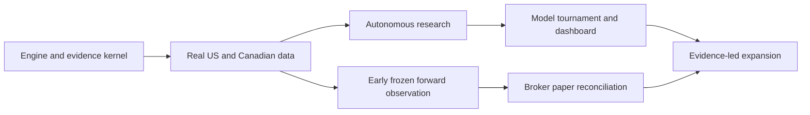

# Delivery Roadmap

> September 18 delivery correction: the destination is an automated daily/weekly trading operator. The portfolio operating loop now takes priority over further research-dashboard expansion. See [the updated delivery plan](automated-trading-plan.md) for implemented paper operation, broker findings, reasoning and remaining live-deployment gates.

Date: 2026-09-18

Status: partially implemented as of September 18, 2026. A runnable local research
workstation now exists under `src/frontier`. The acceptance contracts below remain
the broader delivery target; they are not all satisfied by the current build.
The system design is [here](superpowers/specs/2026-09-18-frontier-trading-system-design.md).
Current commands are in the [README](../README.md), with consolidated verification
in [validation](validation.md).

## Current milestone assessment

| Milestone | September 18 status | Why the full milestone remains open |
| --- | --- | --- |
| M1 — research kernel | Runnable bounded implementation: actual Nautilus accounting, immutable data/runs, strict timing, reports and exact replay. | Full equity corporate-action semantics are not qualified. Cash dividends with payment dates now pass lifecycle tests; splits remain rejected; LEAN was not executed. |
| M2 — real data/baselines | US/Canada daily samples plus a 41-instrument five-year scanner capture, 434 US SPY hourly bars, dated BoC FX, fixed baseline/cost tournaments and access ledger. | Canadian hourly data, complete actions, longer point-in-time history and continuous nested walk-forward evaluation remain absent. |
| M3 — research factory | Two actual two-call Codex campaigns using existing ChatGPT access, typed templates, real feedback and persisted attempts. | Broad autonomous research, isolated outer holdouts, resumable scheduling and measured multi-agent advantage are not established. |
| M4 — tournament/dashboard | Local React/FastAPI workstation and comparison/inspection workflows are implemented. | Advanced statistical/ML families, Qlib/RD-Agent comparisons and adaptive scheduling remain future work. |
| M5a — frozen observation | Freeze and as-of observation commands exist for compatible appended datasets. | No accumulated prospective outcomes or continuously refreshed, recovered observation service is claimed. |
| M5b — broker paper | Not qualified or enabled. | No broker orders, account reconciliation or execution/recovery evidence. |
| M6 — live expansion | Future scope. | Requires validated evidence and an explicit live-capital mandate. |

The unchecked lists below preserve the original acceptance scope rather than
pretending that partial delivery closes every item. Consult the dated assessment,
[progress ledger](progress.md), and task reports for implemented subsets.
Original `trading_agent` file names were planning placeholders; the concrete module
map below records the current `frontier` implementation.

## Delivery method

Each milestone produces a usable vertical slice, its decision records, meaningful tests, a reproducible demonstration, and an independent review. Routine task execution is autonomous after the overall design is accepted. Findings change the implementation; successful milestones are not expanded with unrelated polish before the next capability is delivered.

Before implementing each milestone, write a concrete task plan against the verified interfaces and engine revision. Later milestones are deliberately specified by their contracts rather than inventing dependency APIs before the first integration has run. Implementation plans are technical working documents, not repeated requests for user approval.

Every material decision record contains: requirement, chosen approach, alternatives, concise rationale, evidence/test, downside, and revisit condition. Reviews compare results to requirements and seek counterexamples. No claim rests on an agent's self-assessment alone.

## M1. Reproducible research kernel

**Outcome:** qualify one engine for the US/Canada mandate, then provide one local command creating an engineering evidence report from a frozen fixture, with real engine results and inspectable USD/CAD accounting.

**Files and responsibilities:**

| Current path | Responsibility |
| --- | --- |
| `pyproject.toml`, `uv.lock` | Isolated Python 3.13 application and locked dependency resolution. |
| `src/frontier/domain.py` | Versioned instrument, dataset, strategy and run contracts. |
| `src/frontier/data.py`, `src/frontier/fixtures.py` | Immutable imports, temporal reads and fictional engineering fixtures. |
| `src/frontier/store.py` | SQLite run and evaluation-access registry. |
| `src/frontier/replay.py` | Actual Nautilus execution, shared native-currency account and built-in strategies. |
| `src/frontier/metrics.py`, `src/frontier/reports.py` | Descriptive metrics and standalone evidence reports. |
| `src/frontier/campaign.py` | Frozen deterministic tournament and identical financial replay verification. |
| `src/frontier/providers.py`, `src/frontier/research.py` | Existing Codex access and bounded typed model campaigns. |
| `src/frontier/observation.py`, `src/frontier/workflow.py` | Frozen strategy observations and persisted workflow artifacts. |
| `src/frontier/sources.py`, `scripts/import_session_snapshots.py` | Narrow read-only source capture and retained sample imports. |
| `src/frontier/cli.py`, `src/frontier/web.py`, `frontend/` | CLI and local FastAPI/React workstation. |
| `Launch Frontier.cmd`, `scripts/start.ps1` | Workspace-aware Windows launcher. |
| `engines/qualification/` | Candidate runtime probes and qualification evidence. |
| `tests/test_*.py` | Accounting, temporal, data, provider, workflow, API and CLI verification. |

A remote CI workflow and additional qualification fixtures remain delivery work;
local verification does not imply an unrun Linux or remote CI result.

**Ordered work:**

- [ ] Verify available local runtimes without assuming an executable implies a working service. Qualify stable Nautilus 1.231.0 and standalone LEAN from a resolved immutable revision/build; capture Python/.NET/container versions, dependency locks, and engine/connector licenses. Current LEAN Python interop uses a separate runtime from the Python 3.13 coordinator.
- [ ] Run the same two-market accounting fixture against each candidate. Mandatory cases: native equity identity, CAD/USD cash, split/dividend actions, Canadian calendar, symbol mapping, no paid-service dependency for offline replay, and stable normalized outputs. Broker mapping is a separate source/capability check until authorized paper testing.
- [ ] Document a pass/fail capability matrix and the smallest necessary extension for each candidate. Prefer the candidate satisfying all mandatory semantics with less project-owned execution/accounting code. LEAN's official IB subscription and USA-only equity paths are explicit limitations; never bypass license checks or relabel generic custom data as a traded Canadian equity.
- [ ] Select one primary engine, implement a narrow justified extension if required, and rerun the same fixture. If no candidate qualifies, M1 remains incomplete while the specific integration gap is resolved; independent data/registry work can continue. Do not invent a universal execution kernel to conceal failure.
- [ ] Establish uv project isolation and CLI packaging; capture the exact version lock. Do not modify global Python or machine-wide configuration as incidental setup.
- [ ] Define schema versions, UTC times, availability basis, manifest identity, experiment lineage, and engine result references.
- [ ] Build the SQLite registry with registered/running/evaluated/rejected/failed states, attempt records, and append-only evaluation-access events.
- [ ] Add a two-market fixture with ordinary fills/fees, a split, a dividend, a symbol-history event, unavailable instrument handling, separate CAD/USD cash, an FX move, interlisted/same-ticker identity, and a holiday where only one market trades. Use engine-specific action semantics verified from the pinned source.
- [ ] Feed close-derived targets only into an eligible later execution point. Compare resulting cash/holdings/fees/actions with an independently calculated fixture.
- [ ] Render the ledger, input availability, decisions, benchmark comparison, costs, and limitations. Mark the entire artifact `engineering_fixture`.
- [ ] Prove deterministic replay and future-data mutation invariance. Run local Windows integration and Linux CI when a remote runner is available; report unavailable CI as unrun, not passed.
- [ ] Review actual artifacts and close all correctness findings before declaring M1 complete.

**Acceptance:** no fabricated engine outputs; a frozen run repeats its decisions and accounting; changing data after a decision cannot change that decision; corporate-action and FX fixtures reconcile; both markets' temporal and instrument semantics are demonstrated; a failed run remains inspectable; one command emits both JSON and HTML. A broker-paper connection is qualified in M5b, not implied by an M1 mapping check. All app commands exit visibly on invalid input or unavailable engine dependencies.

**Current runnable command:** `.venv\Scripts\python.exe -m frontier.cli demo`. It persists a registry record plus `result.json` and `report.html` under the returned artifact directory. This bounded synthetic demonstration does not close the broader corporate-action acceptance requirement.

## M2. Real data and honest baselines

**Outcome:** reproducible evaluation on declared US and Canadian stock/ETF universes, with source provenance and data-quality limitations. Daily and hourly evaluations are separately qualified lanes supporting the hours-to-weeks mandate.

- [ ] Implement the minimum connectors providing both countries' required coverage using actual existing/free entitlements; preserve raw snapshots and license/usage metadata. Record daily/hourly history and corporate-action completeness separately.
- [ ] Add calendar, symbol, corporate-action, and availability checks. Connectors reject incomplete required records explicitly; no successful response is synthesized.
- [ ] Add timestamped USD/CAD reference/valuation data and distinguish it from executable conversion quotes. Test a decision before Bank of Canada daily publication and a market holiday mismatch.
- [ ] Freeze universe, feature history, execution-price series, and a dated campaign split.
- [ ] Run cash, passive, trend, and mean-reversion baselines with common costs and assumptions. Compare raw-price accounting with total-return expectations where applicable.
- [ ] Add train-only preprocessing, nested chronological split generation, overlap purging, uncertainty reporting, and predeclared adverse cost/delay scenarios.
- [ ] Use a continuous walk-forward portfolio with non-overlapping evaluation periods and carried cash/holdings/orders. Test a position spanning a model-update boundary. Keep independent fold diagnostics separate, with explicit reset/liquidation costs and no misleading concatenation.
- [ ] Add a global validation-access ledger so a previously exposed test period remains exposed across campaign renaming.
- [ ] Produce a report that separates valid, insufficient, and invalid evidence; publish zero-alpha outcomes with the same completeness as positive ones.

**Acceptance:** both countries' data inputs and use restrictions are identifiable; every return traces to native-currency positions/cash flows and timestamped FX; country-specific and combined benchmarks are shown; all trials and access events remain visible; no current-universe or revised-data result is advertised as point-in-time evidence. Report the hourly lane as incomplete if suitable intraday data is unavailable; a daily success does not close that requirement.

**Dependency:** an adequate dataset, either already available or chosen with the owner. Development fixtures continue while external account/data access is unavailable; they never substitute for M2 completion.

## M3. Autonomous research factory

**Outcome:** a bounded research campaign runs from a natural-language mandate to a reviewed evidence report without manual intervention between experiments.

- [ ] Implement typed hypothesis output: mechanism, formula/template, timing, horizon, failure conditions, ablation, and dependencies.
- [ ] Add provider-neutral model invocation, recorded prompts/responses/tool versions, request budgets, and measured usage. The default development profile has paid calls disabled.
- [ ] Discover a usable local, free, or already entitled real-model provider without assuming a chat subscription is a backend API key. Separate `replay_fixture` from `real_model_campaign` throughout outputs.
- [ ] Build the initial deterministic formula/template compiler; unsupported proposals are recorded with a reason.
- [ ] Introduce proposer, critic, experiment worker, and evidence reviewer with raw artifact access. Compare this workflow with one competent agent using the same budget.
- [ ] Implement durable job ownership, per-campaign attempt/trial counters, duplicate-hypothesis families, and resumable completed artifacts.
- [ ] Keep outer/final evaluation results and derived information out of every candidate-influencing role, tool, memory, critic, and coordinator feedback until freeze/closure. Inject a held-out canary and prove it cannot reach proposal/refinement prompts or feedback.
- [ ] Add search-aware evaluation, cost/latency measures, candidate ablations, and explicit stopping conditions tied to budget or evidence.
- [ ] Run a conventional fixed-search comparator under the same experiment budget.

**Acceptance:** an actual available model generates a new executable proposal, consumes genuine evaluation feedback, and completes a bounded campaign; every consumed dollar/token and tested variant is recorded; no worker can declare promotion through prose; a restart preserves history; additional agents demonstrate a measured benefit or remain disabled. A replay fixture or early stop caused by unavailable model access validates only orchestration and does not complete M3. Continue deterministic research if model access is unavailable and report that external dependency explicitly.

**Open-ended code lane:** add only after process/container isolation, resource limits, read-only dataset mounts, restricted credentials/network, and observed result validation are demonstrated. Generated Python executed with `exec` in the application is not an acceptable integration.

## M4. Model tournament and control dashboard

**Outcome:** competing strategy families and models can be compared through one evidence interface.

- [ ] Add regularized linear and boosted-tree baselines using identical data access and allocation rules.
- [ ] Integrate Qlib/RD-Agent as a separately versioned comparison lane where its environment/data requirements fit.
- [ ] Add eligible foundation-model and text-extraction challengers; label potential historical LLM contamination explicitly.
- [ ] Implement covariance/forecast shrinkage and cost-aware constrained allocation; compare with the capped simple allocator before adoption.
- [ ] Add the research queue, genealogy, fold comparison, decision replay, budget, and operations views to a local FastAPI/React app.
- [ ] Add a research scheduler based on measured information gain/cost and compare with a fixed queue.

**Acceptance:** same-data/same-budget comparisons; decisions explainable from stored inputs; prospective sample sizes visible; a complex model or scheduler can lose and be rejected without breaking the product.

## M5a. Early prospective baseline observation

**Outcome:** begin accumulating frozen forward decisions as soon as M2's relevant data lane passes, while autonomous research and the advanced dashboard are still being developed.

- [ ] Freeze simple baseline strategies, source cadence, daily/hourly lane, observation objective, and evaluation schedule.
- [ ] Capture decisions before outcomes, retain native/cross-currency marks, and simulate fills with explicit assumptions.
- [ ] Run data-freshness checks, scheduler recovery, and a concise daily report without requiring the full dashboard.
- [ ] Continuously monitor operational health; evaluate performance only at the predeclared horizon/schedule or under an explicit sequential-testing policy.

**Acceptance:** dated uneditable prospective decisions and outcomes, visible paper-fill assumptions, restarts preserving strategy identity, and no claim of broker or real execution validation. This lane does not wait for an LLM provider or advanced model tournament.

## M5b. Broker paper operation and reconciliation

**Outcome:** frozen strategies operate prospectively with accountable orders, reconciliation, and daily evidence.

- [ ] Choose the actual paper account/venue from available owner accounts. IBKR is a candidate, not an assumed account or authorization.
- [ ] Verify source feed, calendar, permissions, adapter/runtime versions, order types, and paper-account identity.
- [ ] Demonstrate correctly identified US and Canadian equity/ETF contracts, CAD/USD balances, and venue-specific paper execution. Do not infer broker entitlement from public research-price access.
- [ ] Run frozen strategy versions against new data; maintain separate targets, intents, acknowledgments, fills, and broker observations.
- [ ] Test delayed/partial fills, rejected orders, reconnects, duplicate events, and uncertain submission using actual adapter semantics.
- [ ] Record expected versus broker-simulator costs/positions and contemporaneous market quotes. These observations do not prove real market impact, queue priority, or slippage. Halt new risk on unresolved state according to the paper mandate; liquidation is a separate policy.
- [ ] Deploy the durable scheduler, meaningful-change notifications, daily report, restart recovery, and operator controls.
- [ ] Run champions and challengers prospectively; forbid retrospective edits to prior predictions or strategy identity.

**Acceptance:** successful reconstruction of all orders/positions and interventions; no unexplained account discrepancy; repeatable recovery; source freshness and runtime status visible. Report operational reliability and statistical evidence separately.

**Dependency:** a running host and usable account/data access. A laptop that is asleep is not a 24/7 deployment. Cloud provisioning and recurring costs require an explicit spending decision.

## M6. Evidence-led expansion and live deployment

**Outcome:** extend the validated system where additional markets or capital have a justified benefit.

- [ ] Select the next research track using demonstrated opportunity/data feasibility. Candidates: cross-sectional equities with historical membership, SEC event extraction, crypto funding/basis, futures, and volatility strategies.
- [ ] Define the track-specific data/accounting/execution contracts before enabling it. Funding, borrow, margin, multipliers, expiry, exercise, settlement, and market-resolution rules are not interchangeable.
- [ ] Evaluate Nautilus for a crypto/derivatives lane against the same portfolio/evidence interfaces; avoid maintaining two engines until this integration has a concrete benefit.
- [ ] Benchmark capacity, degradation, uncertainty, and operational costs for proposed live strategies.
- [ ] Prepare a concrete live mandate for user authorization: exact account, capital, strategy versions, instruments, exposure/loss rules, operational response, and spending.
- [ ] Enable live operation only within that authorized mandate; subsequent research and paper tests remain autonomous. Capital/permission expansions are new decisions.

**Acceptance:** reproduce the evidence underlying deployment, trace real trades to authorized frozen versions, and report net observed performance honestly. The platform can reach engineering maturity even if no strategy qualifies for capital.

## Dependency order and work that can run in parallel

After M1 establishes result interfaces, dashboard read-only work can proceed alongside M2/M3. Data acquisition and engine integration can be independently researched. M5a starts after its M2 data lane passes, without waiting for M3/M4; this captures predictions, not only raw market data. Broker adapter investigation proceeds early, but M5b waits for actual account configuration, connector entitlement, and its mandate. Independent advanced-model candidates are optional comparisons rather than prerequisites for basic forward operation.

## Approval and automation policy

One overarching architecture approval establishes the development direction. Do not request it again if already established in the conversation. The implementation agent then makes and documents routine technical choices, performs independent reviews, runs tests, and advances between completed milestones without per-file or per-experiment approvals. US/Canada stocks and ETFs, hours-to-weeks, and existing/free-only access are confirmed user requirements.

Ask only when missing user-owned information prevents the next concrete action, a new paid commitment is needed, live-money authority is proposed, or a material change to the agreed mandate is necessary. Prepare the evidence and exact action before asking. Never confuse a blocked external integration with completion of that milestone.
