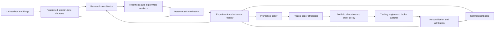

# Frontier Trading System Design

> September 18 delivery correction: the destination is an automated daily/weekly trading operator. The portfolio operating loop now takes priority over further research-dashboard expansion. See [the updated delivery plan](../../automated-trading-plan.md) for implemented paper operation, broker findings, reasoning and remaining live-deployment gates.

Date: 2026-09-18

Status: architecture approved by user delegation; implementation and executable qualification underway. Current evidence is tracked in docs/progress.md.

## 1. Mandate and current facts

Build an ambitious one-person trading system that automates research, engineering, evaluation, and routine operation. Record concise decision rationale, alternatives, evidence, and a condition for revisiting important choices. Use straightforward code, explicit contracts, and visible failures. Avoid speculative abstraction, silent fallbacks, and layers of error handling without a demonstrated failure to address.

The workspace was empty when inspected. Python 3.13, uv, Git, ripgrep, Docker, .NET, Node, and WSL executables are present on Windows. A read-only check found .NET SDK 9.0.310 and no reachable Docker Linux-engine named pipe. Current LEAN source requires a newer .NET runtime, so neither source execution nor a container is already proven ready. Engine dependencies, credentials, and market data remain unverified. Installed command names do not prove a working runtime; no global runtime configuration has been changed.

Confirmed user mandate:

- First market: US and Canadian stocks and ETFs, beginning with a declared liquid universe in both markets.
- Holding period: hours to weeks. Daily and hourly strategy lanes share the evidence system but have separate data, timing, and fill assumptions.
- Financial commitments: use existing access and free resources; ask before new spending.

Engineering defaults and boundaries:

- Initial operating authority: local development, historical research, and simulated paper operation.
- The first engineering fixture uses daily events; M2 adds real daily and hourly research where adequate source access exists. Passing daily tests does not qualify the hourly lane.
- Preserve separate USD and CAD cash balances and report portfolio value in either currency. CAD is the initial display default, a reversible interface preference rather than an assumption about the owner's account currency.
- Live capital, brokerage identity, account permissions, and actual loss/exposure limits remain unset. These are not guessed from a paper example.

The first market limits the initial experiment, not the ultimate architecture. Options, futures, crypto, and event markets are later research tracks with their own market models and evidence requirements.

## 2. Product outcome and evidence standard

The owner should be able to express a research mandate, see experiments run automatically, inspect why candidates failed or advanced, observe frozen strategies prospectively, and understand actual portfolio exposures and costs.

State-of-the-art is an evaluation outcome. Record the task, dataset vintage, date range, universe, model/version, information access, search budget, costs, baselines, and uncertainty alongside any such claim. Software correctness, research productivity, and trading performance are three different scorecards.

### Distinctive capabilities

1. **Experiment genealogy:** every proposed mechanism, feature variation, parameter trial, rejection, and descendant remains searchable. Similar ideas share a research family rather than pretending to be independent discoveries.
2. **Decision replay:** reconstruct what information was available at a decision, which frozen strategy version acted, and the resulting intended and actual orders.
3. **Research budget allocator:** choose experiments by a declared combination of expected information value, diversity, prior failure evidence, runtime, and cost. Compare this scheduler with a fixed conventional search before treating it as an improvement.
4. **Strategy tournament:** simple rules, statistical models, boosted trees, foundation models, and agent-generated strategies face common data, allocation, and execution assumptions.
5. **Prospective challenger operation:** new versions run beside frozen champions; their evidence starts before outcomes occur. A challenger cannot inherit its predecessor's track record.
6. **Execution attribution:** separate signal performance, market exposure, sizing, turnover, fees, slippage, and operational discrepancies.
7. **Source-linked event research:** extract structured evidence from filings and news with publication provenance. Test its incremental value against price-only models.

## 3. Architecture

Research workers generate artifacts and proposals. They do not mutate deployed strategies, calculate authoritative accounting through prose, or bypass the portfolio operator. A portfolio operator accepts versioned target exposures, applies a declared mandate, and delegates order lifecycle/accounting to the chosen engine. Broker observations remain authoritative for actual positions and fills.

Start as one Python application with explicit modules and isolated experiment processes. Run the established trading engine through a narrow process boundary. Introduce distributed workers only when a measured workload requires more than one machine.

## 4. Architecture decision records

| ID | Decision | Reason and alternative considered | Revisit when |
| --- | --- | --- | --- |
| D01 | US and Canadian stocks/ETFs, hours-to-weeks; daily fixture first, hourly lane separately qualified | This follows the confirmed mandate. Both countries enter instrument, calendar, FX, and accounting contracts immediately. Daily fixture success establishes engineering only; a fixed universe supports only conditional research claims. | Evidence supports expansion beyond the confirmed mandate. |
| D02 | Python 3.13 control application, uv-managed project environment and lockfile | Uses the available local runtime and scientific ecosystem; versions are captured for replay. Rust/C# custom execution code is unnecessary while mature engines exist. | A required dependency lacks support, or profiling identifies a specific bottleneck. |
| D03 | Qualify LEAN and stable Nautilus against the complete US/Canada mandate before committing to one engine | LEAN leads in US corporate actions but needs a Canadian equity/connector extension; Nautilus offers a more direct Python/broker route but needs qualified corporate-action accounting. Neither is assumed turnkey. Use identical acceptance fixtures to choose the smaller verified integration. | M1 qualification establishes a winner, or a future market changes requirements. |
| D04 | Existing/free-only engine and connector path; capture immutable revisions | Open-source engine availability does not establish free live connector access. LEAN's official IB plugin has its own subscription requirement. Do not remove license enforcement; evaluate already entitled access or an independently licensed integration. | The owner explicitly authorizes a concrete paid option. |
| D05 | Parquet datasets, DuckDB analytical reads, SQLite coordinator-owned registry | Columnar analytics and durable small-scale state have different workloads. Workers produce per-run artifacts; one coordinator commits results. This avoids concurrent multi-process writes into one DuckDB database. | Measured contention or multi-host operation justifies PostgreSQL/object storage. |
| D06 | Explicit research state machine with bounded specialists | Job states, inputs, costs, and resumability are more useful than autonomous conversation alone. A single-agent workflow is the baseline; additional workers must earn their cost. | A framework demonstrates better recovery or throughput on our own benchmark. |
| D07 | Deterministic numerical evaluation and portfolio rules | These operations require repeatable answers and exact accounting. LLMs are useful for hypotheses, code, critique, document extraction, and investigations. | A learned component beats a named baseline under the same evidence rules. |
| D08 | Candidate representations begin with typed formulas and approved strategy templates | This allows autonomous creativity with inspectable feature access and reproducible compilation. Arbitrary generated code needs a genuinely isolated execution environment; a Python subprocess alone is not that environment. | The sandboxed experiment runner is available and an open-ended code lane adds measured value. |
| D09 | Keep deployed versions immutable; use challengers for adaptation | Self-editing a running strategy destroys attribution and silently changes the experiment. New versions can still be generated and evaluated continuously. | Never silently; any new adaptation policy is itself versioned and evaluated. |
| D10 | Optimize portfolios after costs with shared exposure constraints | Shared allocation reveals whether a signal adds value beyond leverage or market exposure. Begin with simple allocation baselines, then a convex cost-aware formulation. | Non-convex instruments or execution constraints provide a demonstrated reason to change. |
| D11 | Local CLI and evidence report first; FastAPI/React control dashboard follows | The dashboard reads the same recorded artifacts as automated reports. A separate polished interface becomes useful once real state exists. | First end-to-end artifacts are stable enough to expose. |
| D12 | Provider-neutral model calls with per-job budget records | Model names and prices change. Strong reasoning is reserved for decisions that benefit; cheap deterministic scans handle routine data. Chat app access is not assumed to be a backend API credential. | Evaluation shows another provider or routing policy improves quality per unit cost. |
| D13 | A scheduler drives bounded jobs; freshness comes from source events and exchange calendars | Always-on behavior requires a durable runtime, not an indefinitely growing chat. Daily equities and continuous crypto have different schedules. | A new data source or market requires another cadence. |
| D14 | Tests target temporal integrity, accounting, execution, and recovery | These establish whether results mean what they claim. Avoid tests that merely repeat implementation details or defensive wrappers. | Observed failures reveal a missing business invariant. |

Research reference implementations such as Qlib/RD-Agent are reproducible comparison lanes, not mandatory dependencies of the first runtime. Their data assumptions and environment requirements must be tested before integration. LEAN's Python runtime is isolated from the Python 3.13 control process through files/structured process results; their interpreter versions need not match.

The engine qualification produces a capability matrix for US and Canada separately: historical data import, native equity identity, exchange calendar, currency/cash conversion, actions, order model, and broker contract mapping. A source-level extension mechanism is not proof that the market works. In particular, ingesting a TSX price as a generic custom-data security does not prove that an equity order can be routed through a broker adapter. Canada cannot be silently dropped to obtain a passing demonstration.

Choose the candidate that satisfies mandatory market/accounting tests within existing/free access with the least project-owned execution code, then compare reproducibility and runtime cost. If neither passes, record the exact missing capability and implement a narrow, tested integration only if its maintenance burden is justified. A small reference ledger used to verify fixtures is not promoted into a universal trading engine.

## 5. Evidence and data contracts

Each observation has a stable instrument/source identifier, event time, source availability time, local ingestion time, revision identity, and dataset identity. All stored timestamps are UTC; exchange schedules retain their named time zone and session calendar.

- `event_time`: when the economic observation occurred or the bar ended.
- `available_at`: when the source made that version knowable.
- `ingested_at`: when this system obtained it.
- `availability_basis`: observed publication, documented release schedule, inferred, or unknown.
- `revision_id`: identifies amended values without overwriting the earlier vintage.
- `dataset_id`: immutable manifest identifying data files, schema, provider, license/usage limits, and content digests.

Historical simulation uses only records whose availability was established by the decision time. Live replay additionally respects actual ingestion delay. Unknown/inferred availability is explicitly labeled and cannot be upgraded to point-in-time certification merely by assigning a timestamp.

Distinguish raw tradable prices from feature-adjusted series and total-return calculations. Preserve corporate actions, historical symbol mappings, exchange calendars, and historical universe membership. Tests must cover a split, a distribution, and an instrument becoming unavailable. Backfilled current constituents cannot support claims about an unbiased historical equity universe.

Free or incomplete datasets may support development and exploratory research. Missing provenance, corporate actions, or membership remain visible limitations in the evidence report; there is no silent substitution with synthetic or stale data. Synthetic fixtures are exclusively engineering evidence.

### US/Canada requirements

- Identify listings with venue, currency, persistent provider/broker identifier, and dated ticker mapping. A bare ticker is not a global identity. Group interlisted securities by economic issuer/exposure without treating distinct listings as freely interchangeable.
- Preserve each venue's sessions, holidays, half-days, and hourly bar boundaries. Do not fill forward a Canadian holiday into evidence of a tradable session.
- Preserve native-currency cash, costs, distributions, positions, and marks. Reporting conversion is separate from an actual FX trade, spread, conversion fee, and financing obligation.
- Attribute portfolio change to local asset return, FX movement, flows, and costs; aggregate USD/CAD values only with timestamped conversion inputs available at that decision.
- Bank of Canada daily FX observations can support suitably timestamped research/reference valuation. They are indicative daily averages, published by 16:30 ET, not executable intraday conversion quotes. A 10:00 decision cannot use that day's later release.
- Handle US and Canadian corporate actions with provider-specific source conventions and retain raw evidence. Account-specific tax/withholding assumptions are declared in any after-tax result; the default research result is explicitly pre-tax.
- SEC coverage is US disclosure coverage. Canadian disclosure research requires its own accessible source and publication provenance; SEDAR+ extraction or a paid feed is not assumed available.
- Hourly research needs qualified historical intraday data, timestamps, and liquidity/cost assumptions in both markets. Where free access cannot supply that, disclose the exact gap and prepare a concrete data option before requesting expenditure.

## 6. Research and validation contracts

A `ResearchCampaign` freezes the mandate, universe, date ranges, forecast horizon, decision/fill timing, baseline suite, objective, search budget, cost scenarios, selection rule, evaluation-access policy, and prospective evaluation schedule before testing. Use either a fixed final evaluation horizon or an explicit sequential-testing rule; repeatedly inspecting results and stopping at the first apparent win is another selection process. Continuous operational monitoring is independent of statistical promotion.

A `Hypothesis` records the economic mechanism, instruments, feature dependencies, timing, formula/template, expected direction, failure conditions, alternative explanation, and ablation. A proposal without executable rules is research commentary, not a trading strategy.

An `Experiment` records campaign/family/parent IDs, full parameters, dataset and code identities, engine/runtime identity, prompt/model/tool versions, seeds, split definitions, cost assumptions, all outputs, completion status, and time/spend. Failed, invalid, canceled, and abandoned runs remain in the registry.

The research progression is:

`proposed -> specified -> registered -> running -> evaluated -> rejected | paper_candidate`

Execution errors take a separate `failed` state. A scientific rejection is a successful experiment with negative evidence. New versions create new records; a retry records its attempt and reason without pretending to be a new independent hypothesis.

### Evaluation design

1. Compute transformations using training data only. A feature receives only the permitted historical slice.
2. Use nested chronological walk-forward evaluation; exclude training observations whose outcome labels overlap the next evaluation interval.
3. Inner folds choose parameters. Outer evaluation is hidden from every role that can influence candidate construction until the candidate/campaign is frozen: proposer, critic, coordinator, shared memory, tools, errors, and derived summaries. Evidence reviewers can see held-out outputs after freeze. Test this transitively by placing a recognizable canary in held-out artifacts and proving it cannot enter refinement inputs. If results subsequently influence a decision, record the access as adaptive search.
4. A final campaign test is opened once. After inspection it becomes research history, not an untouched test that can be reused under a new campaign name. Overlapping dates and datasets are tracked globally.
5. Show every fold, gross/net returns, benchmark-relative returns, turnover, exposure, concentration, maximum drawdown, cost sensitivity, and dependence-aware uncertainty. Resample portfolio return blocks while preserving temporal dependence and contemporaneous cross-asset dependence. Do not treat overlapping holding periods or repeated outer-test dates as independent observations.
6. Include search-aware statistics such as Deflated Sharpe Ratio with explicit assumptions and sensitivity to effective trial count. A trial includes the full pipeline: universe, horizon, features, preprocessing, model, allocator, ensemble weights, and execution filters. Family grouping never reduces the displayed raw number of trials. PBO/DSR cannot cure leaked inputs.
7. Prospective paper evidence uses the frozen candidate before outcomes are known. Record duration and effective observations; calendar days alone do not establish statistical power.

Candidate comparisons share data, costs, and allocation constraints. Initial baselines are cash, declared passive exposure, a simple trend rule, and a simple mean-reversion rule. Statistical/ML lanes add regularized linear models and boosted trees before more complex challengers. Risk matching uses only training-period estimates.

The deployment estimate uses one continuous walk-forward portfolio with non-overlapping evaluation intervals, carrying cash, holdings, outstanding orders, and costs through scheduled model updates. Independent fold diagnostics may reset a portfolio but are labeled separately, disclose resets/liquidation costs, and are never stitched into a fictitious continuous equity curve. Warm-up does not produce tradable outputs before the strategy's declared readiness. Test an open position spanning a fold boundary.

Report US, Canadian, and combined portfolios separately, including local-currency and common-currency results. Benchmark definitions must state whether foreign-currency exposure is hedged. Apparent relative-value opportunities between interlisted assets require contemporaneous prices, FX, venue liquidity, conversion/transfer rules, and costs; ticker similarity is not an arbitrage signal.

No universal Sharpe, hit-rate, or drawdown threshold is called proof of profitability. Each campaign predeclares its objective and evidence rule. Insufficient evidence is a valid outcome and cannot be replaced with an LLM confidence percentage.

### LLM-specific contamination

An LLM may remember later outcomes even when its retrieved documents are correctly timestamped. Historical language-based predictions are labeled exploratory unless model training provenance supports the evaluation boundary; prospective frozen decisions are the preferred evidence. An LLM can still help write deterministic strategies, but the search process and historical knowledge used to select them must be disclosed. Masking names/dates is a diagnostic, not certification.

## 7. Portfolio and execution contracts

Research outputs versioned forecasts and proposed target exposures. A shared allocator accounts for covariance, estimation uncertainty, transaction/holding costs, concentration, liquidity, and the mandate's gross/net limits. Begin with a transparent capped baseline; only adopt optimization when it improves the controlled comparison.

The initial research/paper profile is long-only, unlevered, whole-share positions, gross exposure at most 100%, and at most 20% of portfolio NAV per economic issuer/exposure group. Unallocated funds remain in their actual currency cash balance with zero modeled interest in the engineering fixture. This profile is a comparison convention, not a live capital recommendation. Benchmark exceptions are separately labeled. Shorting, margin, financing, fractional trading, and active FX hedging are later declared experiments. Market orders execute at the next eligible event with declared fees/slippage; a signal made from an hourly/daily close cannot fill retrospectively at that close.

The engine owns order state and simulated account accounting. Actual broker positions, balances, and fills are independently reconciled. Explicitly distinguish:

`forecast -> target -> intent -> submitted -> acknowledged -> partially_filled | filled | canceled | rejected | unresolved`

These are related records, not a promise that every broker follows one linear sequence. Corrections, partial fills, cancel races, and reconnect events use the chosen adapter's actual semantics.

Use durable strategy/version/decision/account intent identity. After uncertain submission, query broker state before considering another submission. Do not claim exactly-once network delivery; demonstrate duplicate-resistant recovery and visible unresolved outcomes.

Research, historical replay, local simulated execution, broker paper accounts, and live accounts have distinct mode/account identifiers. Paper defaults never establish real-money authority. A live mandate must specify brokerage/account, allowable instruments/order types, capital, exposure limits, loss-response policy, and authorized strategy versions.

Paper fills are simulator/account observations. They establish integration and accounting, not actual market impact, queue priority, or real slippage. Compare prospective signals with contemporaneous quotes and explicit execution assumptions; reserve real execution-cost claims for real fills. A frozen strategy may have a predeclared refit/update policy: its schedule, allowed data, algorithm, and resulting checkpoints are recorded. Unscheduled policy changes create a new challenger.

Stopping new risk and liquidating positions are separate operations. The response to stale data, lost connectivity, or a loss threshold is a versioned mandate rule; the system does not improvise liquidation because a prose agent is concerned.

## 8. Autonomy and workflow

Once the overarching design is approved, routine implementation choices, dependency isolation, coding, tests, local documentation, independent reviews, experiment execution within the configured budget, and local paper infrastructure proceed without repeated design approvals.

Autonomous research runs under explicit job and campaign budgets. An initial unpaid development profile makes zero backend model calls and uses deterministic fixtures/replayed model outputs, labeled `replay_fixture`. Provider discovery includes suitable local, free, and already entitled integrations. Completing autonomous research requires a `real_model_campaign`: a real available model generates a new executable hypothesis and consumes evaluation feedback. Replay output proves orchestration only. Enabling a billable provider requires an available credential and an explicitly authorized spend ceiling. Paid subscriptions, new API spending commitments, and account terms are not inferred from this document.

Agents may propose data repairs and strategy changes; corrections become new dataset/strategy versions. Historical results are not silently overwritten. Repeated failures produce one actionable incident with supporting logs, not notification spam.

Durable jobs record intended inputs, leases, progress, artifacts, attempts, terminal status, and cost. Recovery resumes completed artifacts or reruns an identified incomplete step. A central coordinator performs registry writes and promotion decisions. The scheduler is idempotent for each source/session/job key.

A workday workflow is: update data -> validate freshness -> run approved research budget -> evaluate candidates -> update prospective paper states -> reconcile -> produce evidence report. Markets with different hours use their own source/calendar triggers. Alert only on a meaningful change, failure, completion, or required user action.

## 9. Control interface

The dashboard displays the active mode/account, data freshness, research spend, running/failed jobs, active strategy versions, target and observed positions, and unresolved discrepancies.

Views:

- Research queue with mechanism, status, lineage, and budget.
- Experiment comparison with full trial counts, folds, baselines, costs, and uncertainty.
- Decision replay showing permitted inputs, strategy outputs, allocation, orders, and fills.
- Portfolio attribution separating exposure, selection/timing, costs, and execution.
- Champion/challenger comparison with frozen-version dates and prospective sample sizes.
- Operations view with source lag, restart/reconciliation history, and intervention controls.

Demo fixtures, historical estimates, paper observations, and real trades have visibly different labels. The first report is a standalone local HTML artifact; the later interactive application consumes the same documented result schema.

## 10. Acceptance scorecard

| Area | Acceptance evidence |
| --- | --- |
| Reproducibility | Same frozen inputs reproduce decisions, order sequence, positions, fees, and metrics; numerical tolerances are explicit and differences are shown directly. |
| Time integrity | Mutating future records cannot change earlier features, targets, or orders; revisions cannot appear before their availability. |
| Accounting | Independently worked USD/CAD cash/trade/fee/split/dividend/FX fixtures reconcile to instrument precision, including an open position across a fold boundary. |
| Market coverage | US and Canadian instruments, session differences, equity identities and currency conversion are demonstrated independently; hourly coverage is qualified separately from daily coverage. |
| Execution timing | A close-derived decision executes only after that information was available and within the declared market/order model. |
| Search honesty | Every attempted variant and validation access appears in the campaign record; relabeling a campaign cannot restore test secrecy. |
| Benchmark fairness | Common data, costs, exposure rules, and search budgets; explain all deviations. |
| Agent value | Real-model campaigns compare completion/reproducibility rates, defects detected, elapsed time, token spend, and surviving evidence with simpler workflows; replay fixtures do not satisfy this criterion. |
| Recovery | Interrupt jobs and uncertain order submissions at actual integration boundaries; restart without losing completed evidence or inventing account state. |
| Paper operations | Frozen strategy, fresh data, consistent account reconciliation, and observed execution-cost attribution. |
| Performance claims | Named benchmark, frozen protocol, sufficient observations, uncertainty, full search history, and prospective corroboration. |

## 11. Delivery boundaries

Deliver in complete vertical slices described in [the roadmap](../../roadmap.md). The first slice proves the environment, temporal contracts, accounting integration, replay, and evidence report using fixtures. It does not claim alpha. Subsequent slices add real data, research automation, model tournaments, and broker paper operation.

No timeline is promised before engine/data integration has been measured. Progress is reported as demonstrated capabilities and remaining dependencies. If an engine/data dependency fails its acceptance criteria, resolve that specific finding and update the decision record rather than substitute an unverified implementation.

## 12. Sources and what they establish

Sources checked on 2026-09-18. Product documentation can change; implementation captures exact dependency revisions.

- [RD-Agent research and implementation](https://github.com/microsoft/RD-Agent): precedent for automated hypothesis/experiment loops; reported results are not our performance evidence.
- [R&D-Agent-Quant paper](https://arxiv.org/abs/2505.15155): factor/model co-optimization as a research design reference.
- [Qlib point-in-time documentation](https://qlib.readthedocs.io/en/latest/advanced/PIT.html): preserving historical information versions.
- [Deflated Sharpe Ratio](https://www.davidhbailey.com/dhbpapers/deflated-sharpe.pdf): selection bias, trial count, non-normal returns, and uncertainty.
- [What survives honest evaluation?](https://arxiv.org/abs/2608.27734): recent preprint distinguishing leakage controls from search correction; its empirical findings are limited to its experiments.
- [LLM sentiment and lookahead bias](https://arxiv.org/abs/2309.17322): historical language-model predictions require contamination scrutiny.
- [Multi-period trading via convex optimization](https://stanford.edu/~boyd/papers/cvx_portfolio.html): explicit risk/cost-aware portfolio objectives.
- [LEAN source](https://github.com/QuantConnect/Lean) and [equity corporate actions](https://www.quantconnect.com/docs/v2/writing-algorithms/securities/asset-classes/us-equity/corporate-actions): established engine and equity event handling; data entitlement is separate.
- [Nautilus stable 1.231.0](https://pypi.org/project/nautilus-trader/1.231.0/), [release-candidate installation](https://nautilustrader.io/docs/latest/getting_started/installation/), and [corporate-action issue](https://github.com/nautechsystems/nautilus_trader/issues/3307): version/platform and equities-integration considerations.
- [DuckDB concurrency](https://duckdb.org/docs/current/connect/concurrency): analytical database process ownership.
- [uv lockfiles](https://docs.astral.sh/uv/concepts/projects/layout/): reproducible dependency resolution.
- [SEC EDGAR APIs](https://www.sec.gov/search-filings/edgar-application-programming-interfaces): official filings access; source usage requirements belong in the connector.
- [Bank of Canada exchange rates](https://www.bankofcanada.ca/rates/exchange/) and [Valet API](https://www.bankofcanada.ca/valet/docs/): indicative daily FX, publication timing, and free reference access.
- [LEAN equity supported markets](https://www.quantconnect.com/docs/v2/writing-algorithms/securities/asset-classes/us-equity/requesting-data) and [brokerage coverage](https://www.quantconnect.com/docs/v2/lean-cli/live-trading/brokerages): documented US equity support does not establish Canadian coverage.
- [LEAN IB connector source and subscription](https://github.com/QuantConnect/Lean.Brokerages.InteractiveBrokers): connector access is separate from the engine's open-source availability.
